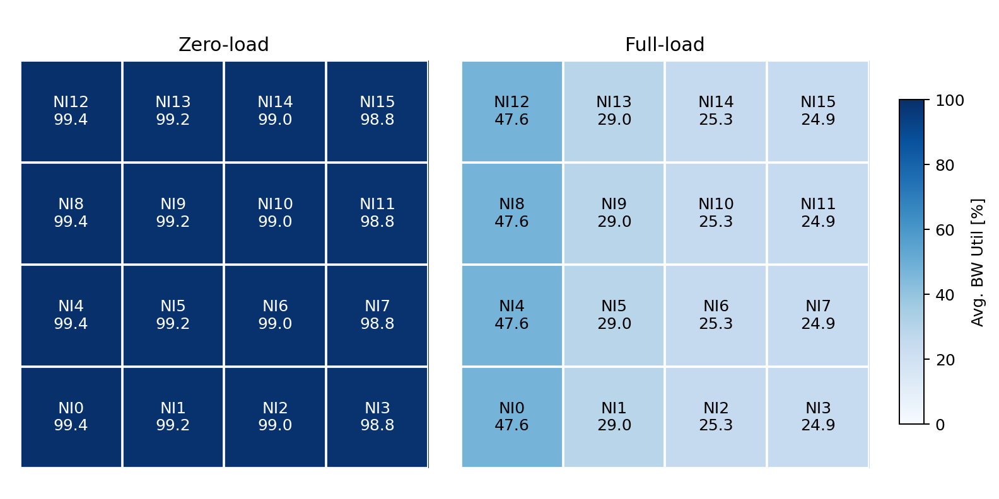
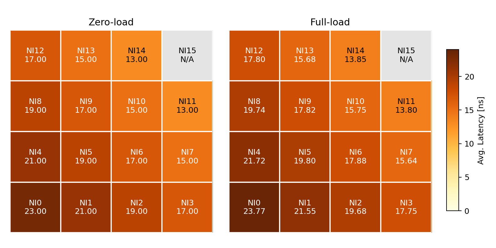

# Boundary memory bandwidth and tile read latency

## 1. Measurement setup

比較 zero-load 與 full-load 下，邊界 memory 的讀取頻寬利用率，以及各來源讀取 NI15 的平均延遲。

Memory reads 仍允許該來源同時有 16 筆未完成；固定讀 NI15 的 narrow reads 則一次只發一筆。

本平台每個 tile 配置一個 AXI source，全部交易為 unicast read。

| Load | Active sources |
| --- | --- |
| Zero-load | One source per run |
| Full-load | All participating sources start together; fixed transaction count per source |


4×4 mesh 的 NI 編號為 `i=4y+x`，y 向上。每列連接一個西側 memory：

| y | Source | Memory | Device endpoint |
| ---: | --- | --- | ---: |
| 0 | NI0–NI3 | M0 | 16 |
| 1 | NI4–NI7 | M1 | 17 |
| 2 | NI8–NI11 | M2 | 18 |
| 3 | NI12–NI15 | M3 | 19 |

Memory read 的 AR 經 REQ、資料經 DAT 回傳。Narrow read 的 AR 經 REQ、資料經 RSP 回傳。

### Narrow reads to a fixed destination

多個來源讀取同一個目的地時，AR 到 RLAST 的延遲包含 NI、來回網路與目的端回應。

此目的地配置沿用 FlooNoC Fig. 11(c) [1]。

## 2. Workload and parameters

| Parameter | Memory reads | Narrow reads |
| --- | --- | --- |
| Sources | NI0–NI15 | NI0–NI14 |
| Destination | M0–M3, selected by source row | NI15 (3,3) |
| Transactions per source | 32 | 100 |
| Payload per transaction | 4096 B | 8 B |
| AXI burst | 64 beats × 64 B, INCR | 1 beat × 8 B |
| Payload per source | 131072 B | 800 B |
| Max. outstanding reads per source | 16 | 1 |
| Address allocation | 128 KiB per source, 4 KiB aligned | 256 B ring per source, 32 locations of 8 B each |
| Zero-load runs | 16 | 15 |
| Full-load runs | 1 | 1 |

Memory address aperture 為每個 M 1 MiB；每列四個來源各使用其中 128 KiB。NI15 是 narrow 的目的地，該格標為 N/A。

AXI 與 NoC 的 clock period 均為 1 ns。VIP 不施加額外 response delay、隨機 stall 或 response hold。R／W channel 各自服務，沒有共用吞吐預算。

Memory 的 512-bit R interface peak 為 **64 B/cycle，即 64 GB/s**；[容量核對](results/check/memory/tables/metrics.json)已確認連續 R beats 的間隔為 1 ns。

設定來源：[topology／參數快照](results/read-full/config/recipe.json)、[案例設定](results/read-full/provenance/source/dv/config/cases.json)、[本批條件](provenance/formal-preparation.json)。

## 3. Bandwidth and latency metrics

所有時間以 ns 表示。AR 與 RLAST 均取 VALID、READY 同時成立的握手時刻，Tclk = 1 ns。

### Timing differences from FlooNoC

BW utilization 的計算結構依據 FlooNoC 隨論文附的 [plots.py](provenance/reference/scripts/plots.py) 中 `plot_bw_heatmap()`：以每個 hart 的量測 cycles，將傳輸資料量換算成 BW，再除以每個 memory channel 的峰值。其程式同時保留 wide-link 與 HBM 正規化公式，Fig.11 使用 HBM 正規化結果。本平台以已核對的 memory R interface peak 64 GB/s 正規化。

FlooNoC 原始繪圖使用軟體量測區段的 cycles，BW 程式提供可選的預熱區段排除（預設 0），narrow latency 則扣除 3 cycles 的指令開銷。本平台使用 AXI handshake timestamp，不套用這些軟體修正。公式已核對原始程式與本專案 [performance.py 快照](provenance/performance.py)，尚未逐項核實原 benchmark 的計時起訖與本平台一致。

## 4. Memory reads: tile and memory bandwidth utilization

量測 16 個 tile 各讀取 128 KiB 時，每個 tile 和每個 memory port 的頻寬利用率。



- **圖中每格與下表各欄**：一個 tile 完成 32 筆 4096 B 讀取，共收到 131072 B。從該 tile 第一筆 AR handshake 到最後一個 RLAST handshake，起訖 cycle 都計入。每格顯示該 tile 的平均接收頻寬占 64 B/cycle 的百分比。
- **讀表例**：full-load 的 NI0 用 4301 cycles，平均使用峰值頻寬的 47.62%。同一欄位置的四個 tile 在本次實驗得到相同結果。

**各 tile 的平均讀取頻寬利用率 [%]**，依來源的 mesh 欄座標 $x$ 分組。

| Load | $x=0$ | $x=1$ | $x=2$ | $x=3$ |
| --- | ---: | ---: | ---: | ---: |
| Zero-load | 99.37 | 99.18 | 98.99 | 98.79 |
| Full-load | 47.62 | 29.02 | 25.34 | 24.93 |

- **每個 memory 的合計頻寬**：四個來源共用同一個 memory，應以共同時間範圍計算。從所有來源最早的 AR 到最晚的 RLAST，共 8214 cycles（含起訖）。每個 memory 傳出 524288 B，因此 full-load 利用率為 99.73%。這個百分比描述 memory 介面；上表描述個別 tile。[Memory 數據](tables/devices.csv)

## 5. Narrow reads: average latency to NI15

量測 15 個來源各向 NI15 讀取 100 筆 8 B 資料時，每個來源的平均讀取延遲。



- **每格**代表一個來源讀取 NI15 的 100 筆 8 B 交易。每筆從來源 AR handshake 到最後一個 R beat 被接受，取兩個時間戳之差；格內數值是 100 筆的平均延遲，單位為 ns。NI15 是目的地，故該格為 N/A。
- **Zero-load**：每次只啟用一個來源。15 個來源分開量，各格的平均延遲介於 13.00–23.00 ns。
- **Full-load**：15 個來源同時向 NI15 發出讀取，各格來自同一次測試，範圍為 13.80–23.77 ns。兩張圖採相同色階。

完整數據：[來源數據](tables/sources.csv)、[memory 數據](tables/devices.csv)、[案例與共同窗口](tables/points.csv)、[公式與繪圖紀錄](provenance/plot.json)。

每案的 FSDB、設定、log、seed／hash 與 validation.json 位於其 result。Full-load 波形：[memory reads](results/read-full/runs/boundary_read_full/boundary_read_full.fsdb)、[narrow reads](results/narrow-full/runs/boundary_narrow_full/boundary_narrow_full.fsdb)。

## 6. Run validation (2026-11-16)

每個 run 對應一份 FSDB。交易數取自來源端。

| Workload | Runs | Read transactions |
| --- | ---: | ---: |
| Memory reads, zero-load | 16 | 512 |
| Memory reads, full-load | 1 | 512 |
| Narrow reads to NI15, zero-load | 15 | 1500 |
| Narrow reads to NI15, full-load | 1 | 1500 |
| Total | 33 | 4024 |

已核對全部 33 個 run 的 FSDB、來源版本與交易紀錄；依交易重算的頻寬與延遲均與原始報表一致。

Build：`e3caa23aab2d`。

逐 run 證據、mapping、版本、hash、檢查指令與訊號路徑見 [盤點表](tables/inventory.csv) 及 [inventory.json](provenance/inventory.json)。

工作站由已存數據重繪：

```sh
cd /home/mingwei/noc_rtl
make -C sim perf_boundary_plot
```

[1] [FlooNoC (2025), Fig.11 與 §VII](https://arxiv.org/html/2409.17606v2#S7)。工作量設定依據保存在 [plots.py](provenance/reference/scripts/plots.py) 與 [flooccamy_test_cfg.json](provenance/reference/measurements/flooccamy_test_cfg.json)。
