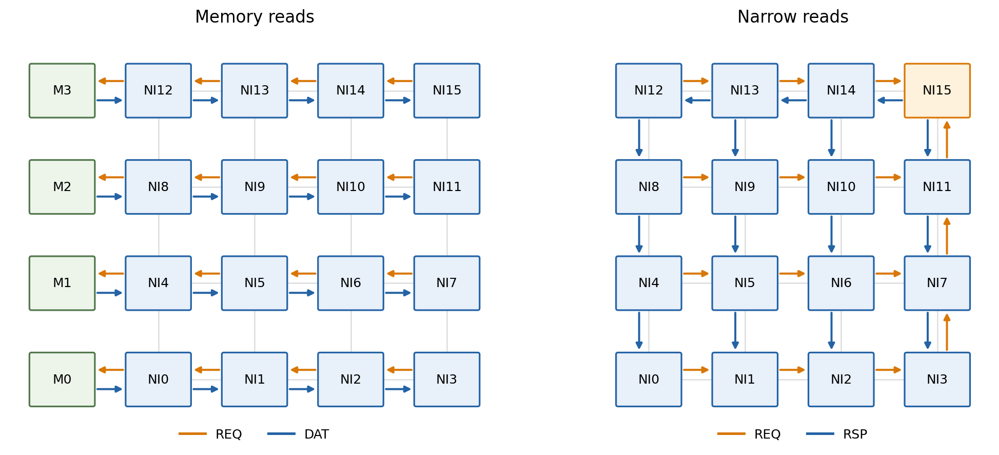

# Boundary 量測場景與結果

## #33 第一步：資料盤點（2026-11-16）

| 資料 | Runs／FSDB | Source read transactions |
|---|---:|---:|
| Memory reads，zero-load | 16 | 512 |
| Memory reads，full-load | 1 | 512 |
| 固定 NI15 narrow reads，zero-load | 15 | 1500 |
| 固定 NI15 narrow reads，full-load | 1 | 1500 |
| 合計 | 33 | 4024 |

本次重新核對 33 份 FSDB 的實際 SHA256、source manifest、交易數、payload bytes、source→device mapping 及時間順序，均一致。原 per-source latency、tile BW 與 memory aggregate BW 可由交易重算；62 列 source 與 20 列 device CSV 數值一致。

本批 build 為 e3caa23aab2d。代表 source 快照的 148 個檔案均符合 manifest，其中 46 份 DUT RTL／define 與 mesh 三個 builds 相同。原 checker／drain 狀態取自各 run 記錄，本次執行離線盤點。

Memory zero-load 仍允許單來源最多 16 outstanding；其平均延遲可能包含自身排隊。Tile BW 採自身 first AR→last RLAST 的 inclusive 窗口，memory aggregate 採共同窗口；latency 採 AR→RLAST、不加一。原 ns 數值依實際 1 ns clock 換算。

代表 FSDB 的完整 hierarchy 包含 16 tiles 與 4 memory endpoints 的 AXI／NI 介面，以及 16 routers 的 FIFO、routing、仲裁 request/select/grant 與 REQ/RSP/DAT 訊號。逐交易配對與服務空檔／仲裁／背壓的動態歸因仍待校準。

目前可直接離線解析 memory 8192／8214 cycles 及各 tile 完成時間。尚未發現必須因缺少訊號補跑的案例。

逐 run 證據、mapping、版本、hash、檢查指令與訊號路徑見 [盤點表](tables/inventory.csv) 及 [inventory.json](provenance/inventory.json)。

## 1. 量測場景

量測 memory reads 的平均 BW utilization，以及各來源到固定右上角 tile 的平均 narrow read latency。場景採用 zero-load 與 full-load 的定義 [1]：

> During zero-load only one core or DMA issues requests and full-load all cores or DMAs issue request simultaneously.

本平台每個 tile 配置一個 AXI source，全部交易為 unicast read。

| 負載 | 啟動方式 |
|---|---|
| Zero-load | 每次啟用一個來源，各來源分別執行 |
| Full-load | 所有參與來源同時開始，各自完成固定筆數的傳輸 |

Full-load 是有限批次。各來源的起訖時間另存於來源數據表。



4×4 mesh 的 NI 編號為 `i=4y+x`，y 向上。每列連接一個西側 memory：

| y | 來源 | Memory | Device endpoint |
|---:|---|---|---:|
| 0 | NI0 至 NI3 | M0 | 16 |
| 1 | NI4 至 NI7 | M1 | 17 |
| 2 | NI8 至 NI11 | M2 | 18 |
| 3 | NI12 至 NI15 | M3 | 19 |

Memory read 的 AR 經 REQ、資料經 DAT 回傳。Narrow read 的 AR 經 REQ、資料經 RSP 回傳。

### Narrow read latency 的量測目的

固定右上角 NI15 為目的地，觀察不同來源位置的遠端小資料讀取延遲。Zero-load 呈現路徑與跳數的影響；full-load 加入多來源匯聚時的競爭。AR 到 RLAST 的時間包含 NI、來回網路與目的端回應，未分離各部分延遲。

FlooNoC Fig.11(c) 採用到右上角 tile 的 narrow reads。§VII-B 說明 mesh 延遲隨跳數改變，並以將 synchronization barrier 放在 mesh 中央為例，說明資料位置會影響延遲 [1]。右上角是本場景的固定測試目的地。

AI workload 中可能對應多個運算 tile 讀取集中存放的完成旗標，確認前一階段資料已就緒。這是依存取形式提出的應用例子；本量測未實作完整 barrier、輪詢流程或 AI 計算，結果代表遠端小資料讀取延遲。

## 2. 工作量與條件

| 條件 | Memory reads | Narrow reads |
|---|---|---|
| 參與來源 | NI0 至 NI15 | NI0 至 NI14 |
| 目的地 | 依來源 y 對應 M0 至 M3 | NI15，座標 (3,3) |
| 每來源筆數 | 32 | 100 |
| 每筆有效資料 | 4096 B | 8 B |
| AXI burst | 64 beats × 64 B，INCR | 1 beat × 8 B |
| 每來源總資料 | 131072 B | 800 B |
| Stimulus read outstanding 上限 | 16 | 1，前筆完成後發下一筆 |
| 位址配置 | 每來源獨立 128 KiB 工作區，4 KiB 對齊 | 每來源 256 B ring，32 個 8 B 位置循環讀取 |
| Zero-load 案例數 | 16 | 15 |
| Full-load 案例數 | 1 | 1 |

Memory address aperture 為每個 M 1 MiB；每列四個來源各使用其中 128 KiB。NI15 是 narrow 的目的地，該格標為 N/A。

共用條件為 AXI／NoC clock 各 1 ns、phase 0、AXI ID 0、seed 1。VIP 不施加額外 response delay、隨機 stall 或 response hold。R／W channel 各自服務，沒有共用吞吐預算。

Memory 的 512-bit R interface peak 為 **64 B/cycle，即 64 GB/s**；[容量核對](results/check/memory/tables/metrics.json)已確認連續 R beats 的間隔為 1 ns。

設定來源：[topology／參數快照](results/read-full/config/recipe.json)、[案例設定](results/read-full/provenance/source/dv/config/cases.json)、[本批條件](provenance/formal-preparation.json)。

## 3. 指標與公式

所有時間以 ns 表示。AR 與 RLAST 均取 VALID、READY 同時成立的握手時刻，Tclk = 1 ns。

### 公式來源與本平台定義

BW utilization 的計算結構依據 FlooNoC 隨論文附的 [plots.py](provenance/reference/scripts/plots.py) 中 `plot_bw_heatmap()`：以每個 hart 的量測 cycles，將傳輸資料量換算成 BW，再除以每個 memory channel 的峰值。其程式同時保留 wide-link 與 HBM 正規化公式，Fig.11 使用 HBM 正規化結果。本平台以已核對的 memory R interface peak 64 GB/s 正規化。

| 項目 | 來源與適用範圍 |
|---|---|
| BW = 有效 bytes／時間；BW utilization = BW／peak × 100% | 對照 FlooNoC `plots.py` 的資料量、cycles 與 peak 正規化算法 |
| 每 tile 使用自身工作窗口 | 對應原始程式依各 hart 的 cycles 計算；本平台窗口取 first AR 至 last RLAST |
| BW 窗口的 `+1 cycle` | 本平台採首末取樣 edge 均計入的定義，未確認為原 benchmark 的計時方式 |
| Memory aggregate 共用窗口 | 本平台用於核對 memory 實際 BW 的彙整定義 |
| Avg. narrow latency | 本平台直接平均 100 筆 accepted AR 到 RLAST 的時間差，沒有 `+1 cycle` |

FlooNoC 原始繪圖使用軟體量測區段的 cycles，BW 程式提供可選的預熱區段排除（預設 0），narrow latency 則扣除 3 cycles 的指令開銷。本平台使用 AXI handshake timestamp，不套用這些軟體修正。公式已核對原始程式與本專案 [performance.py 快照](provenance/performance.py)，尚未逐項核實原 benchmark 的計時起訖與本平台一致。

### Tile BW utilization

每個來源使用自身 32 筆 memory reads 的工作窗口，首末 clock edge 均計入：

```text
C_i = (t_RLAST,last,i - t_AR,first,i) / Tclk + 1
B_i = 32 × 4096 = 131072 B

BW_i [GB/s] = B_i / (C_i × Tclk [ns])
BW_util_i [%] = B_i / (64 × C_i) × 100
```

各 tile 的窗口不同，利用率不能直接相加。

### Memory aggregate BW utilization

同一 run 的所有 memory 使用共同窗口；B_m 為該 memory 在窗口內 accepted R 的有效 bytes：

```text
C_job = (max_i(t_RLAST,last,i) - min_i(t_AR,first,i)) / Tclk + 1

BW_m [GB/s] = B_m / (C_job × Tclk [ns])
BW_util_m [%] = B_m / (64 × C_job) × 100
```

Full-load 範例：

```text
NI0：131072 / (64 × 4301) × 100 = 47.62%
M0 ：524288 / (64 × 8214) × 100 = 99.73%
```

### Average narrow latency

每個來源取全部 100 筆 AR 到 RLAST 的時間差平均：

```text
Avg. latency_i [ns] = sum_k(t_RLAST,i,k - t_AR,i,k) / 100
```

## 4. 實驗結果

33 個正式案例均通過 VCS、checker／drain、各自 FSDB 與輸入重現核對。原始記錄包含 4024 筆 source transactions。

| 指標 | Zero-load | Full-load |
|---|---:|---:|
| Tile BW utilization [%] | 98.79 至 99.37 | 24.93 至 47.62 |
| Avg. narrow latency [ns] | 13.00 至 23.00 | 13.80 至 23.77 |


同一 x 座標的四個 tile，其 BW utilization 相同：

| 負載 | x=0 | x=1 | x=2 | x=3 |
|---|---:|---:|---:|---:|
| Zero-load [%] | 99.37 | 99.18 | 98.99 | 98.79 |
| Full-load [%] | 47.62 | 29.02 | 25.34 | 24.93 |

Full-load 各 memory 接受 524288 B；共同窗口為 8214 cycles，aggregate BW utilization 均為 99.73%。


Zero-load heatmap 各格來自不同的單來源 run；full-load 各格來自同一個多來源 run。兩種負載使用相同色階。

完整數據：[來源數據](tables/sources.csv)、[memory 數據](tables/devices.csv)、[案例與共同窗口](tables/points.csv)、[公式與繪圖紀錄](provenance/plot.json)。

每案的 FSDB、設定、log、seed／hash 與 validation.json 位於其 result。Full-load 波形：[memory reads](results/read-full/runs/boundary_read_full/boundary_read_full.fsdb)、[narrow reads](results/narrow-full/runs/boundary_narrow_full/boundary_narrow_full.fsdb)。

工作站由已存數據重繪：

```sh
cd /home/mingwei/noc_rtl
make -C sim perf_boundary_plot
```

[1] [FlooNoC (2025), Fig.11 與 §VII](https://arxiv.org/html/2409.17606v2#S7)。工作量設定依據保存在 [plots.py](provenance/reference/scripts/plots.py) 與 [flooccamy_test_cfg.json](provenance/reference/measurements/flooccamy_test_cfg.json)。
