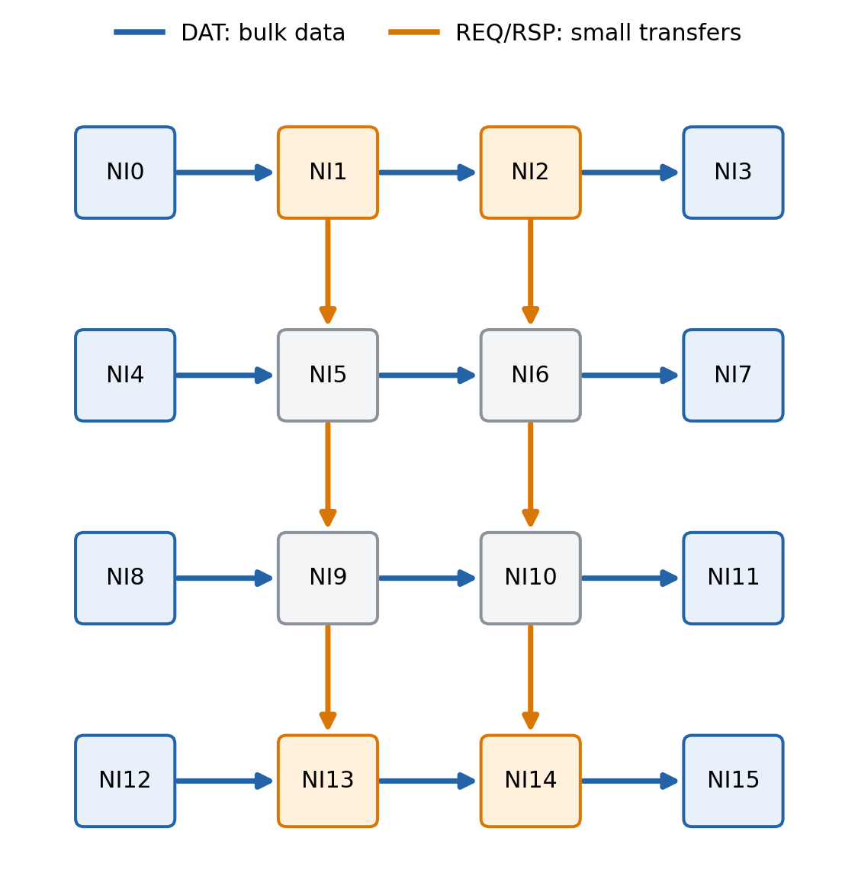
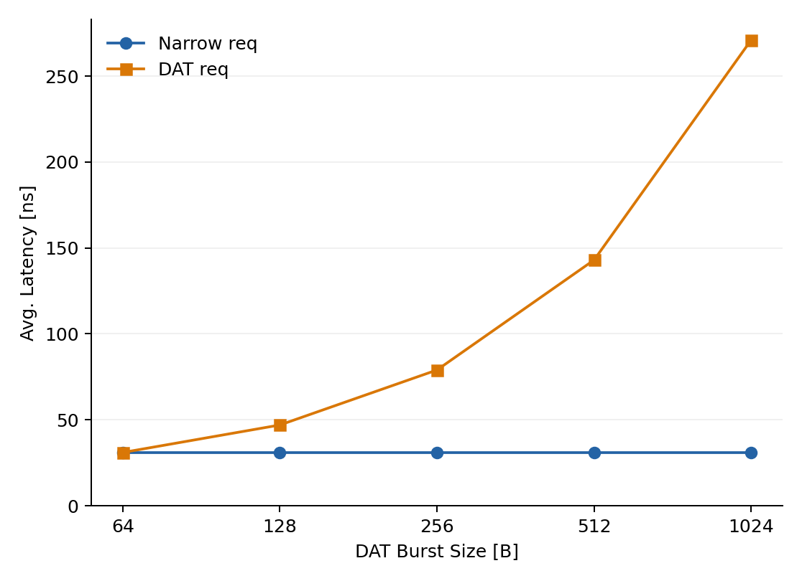

# Write latency under cross traffic

## 1. Measurement setup

改變四條 DAT write 流量的 burst size，量測同時進行的 DAT writes 與 8 B narrow writes 各自的平均完成延遲。

四條 row 從最左側向最右側傳送 bulk writes，走 DAT；中間兩條 column 從上向下傳送固定 8 B small writes，走 REQ／RSP。



| Traffic | Source → destination |
| --- | --- |
| DAT write | NI0 → NI3, NI4 → NI7, NI8 → NI11, NI12 → NI15 |
| Narrow write | NI1 → NI13, NI2 → NI14 |

## 2. Workload and parameters

| Parameter | DAT write | Narrow write |
| --- | --- | --- |
| Payload per transaction | 64/128/256/512/1024 B | 8 B |
| AXI burst | 1/2/4/8/16 beats × 64 B | 1 beat × 8 B |
| AW/W physical link | DAT | REQ |
| B response link | RSP | RSP |
| Number of sources | 4 | 2 |

原生 4×4 mesh／VIP，AXI 與 NoC clock 均為 1 ns、phase 0。設定與實際交易筆數見 [逐來源資料](tables/sources.csv) 及 [案例設定快照](results/cross/split-uni-64/provenance/source/dv/config/cases.json)。

## 3. Average write latency by DAT burst size

- **哪些交易納入平均**：以 ENABLE 為起點，選來源端在第 64 個 cycle 起、到第 576 個 cycle 之前完成 AW handshake 的寫入。已入選的交易都追到 B handshake，即使回應晚於這個區間。
- **兩條曲線與右側兩欄**：對每筆入選交易，從來源端接受寫入位址（AW handshake）量到來源端接受回應（B handshake）。每種流量各自按交易平均。[逐筆時間戳](tables/cohort.csv)



| DAT burst size [B] | Avg. narrow write latency [ns] | Avg. DAT write latency [ns] |
| ---: | ---: | ---: |
| 64 | 31 | 31 |
| 128 | 31 | 47 |
| 256 | 31 | 79 |
| 512 | 31 | 143 |
| 1024 | 31 | 271 |

DAT 寫入從 1 beat 增至 16 beats 時，平均完成延遲由 31 ns 增至 271 ns。同時進行的 8 B narrow writes 在這五個測點都維持 31 ns；結論適用於上列六條寫入路徑。

資料：[圖上數值](tables/points.csv)、[逐來源資料](tables/sources.csv)、[逐筆 cohort](tables/cohort.csv)、[公式與繪圖紀錄](provenance/plot.json)、[程式快照](provenance/performance.py)。每案的設定、log、FSDB、seed／hash 與校準保存在 [results/cross](results/cross/)。

```sh
cd /home/mingwei/noc_rtl
make -C sim perf_cross_plot
```
