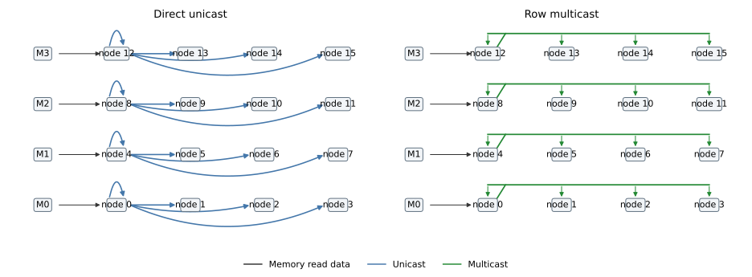
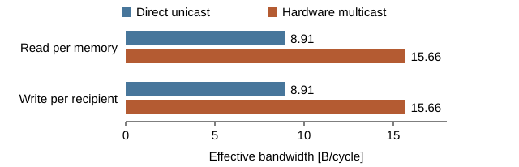
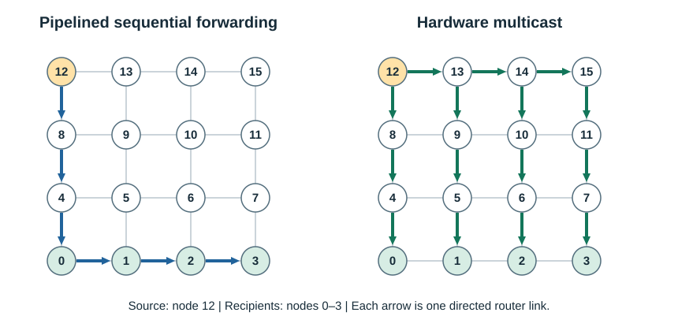
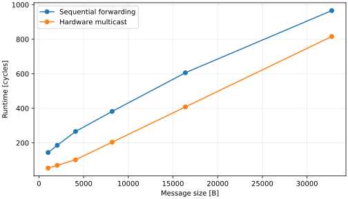
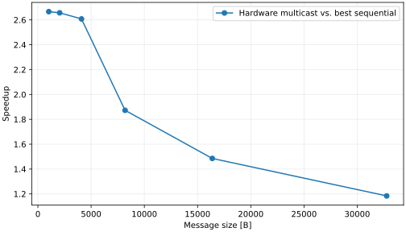

# Multicast performance

## 1. Four-row distribution: direct unicast vs. hardware multicast

四列同時向列內四個節點分發 2 KiB，比較 direct unicast 與 hardware multicast 的收齊時間和連續兩批的啟動間隔。

### Test setup

一輪（batch）是四列各自從 memory 讀取 2 KiB，再由每列最左端的 node 將該列資料分發給同列四個 node。Direct unicast 對四個目的地各寫一次；hardware multicast 每個 burst 只送一次。兩者都包含來源自己的目的緩衝區。

| Parameter | Value |
| --- | --- |
| Message size per row | 2 KiB |
| Destinations per row | 4 |
| AXI clock frequency | 1 GHz |
| AXI data width | 512 bits |
| Memory model | Fixed-latency AXI memory |
| DRAM timing reference | DDR4-2400 (17-17-17) |
| ACT-to-READ delay ($t_{\mathrm{RCD}}$) | 14.16 ns |
| CAS latency ($t_{\mathrm{CL}}$) | 14.16 ns |

假設 bank 已完成 precharge，首筆資料延遲取自 $t_{\mathrm{RCD}}+t_{\mathrm{CL}}$（28.32 ns），以 1 GHz AXI clock 向上取整為 29 cycles，與 memory 端的實測一致。[AXI 交易紀錄](results/feed-multicast-ddr/tables/transactions.csv) · [DDR4 latency 設定依據](https://raw.githubusercontent.com/gem5/gem5/stable/src/python/gem5/components/memory/dram_interfaces/ddr4.py)

### Measured receive latency and prefetch interval

- **Receive latency**：從四列共同開始預取，到目的端接受最後一個 W beat。$x$ 是目的端在該列的位置：最左端（$x=0$）也是分發端，最右端（$x=3$）距離最遠。
- **Prefetch interval**：相鄰兩輪開始預取的時間差。四列都完成寫入確認後才啟動下一輪。

| Metric | Direct unicast [cycles] | Hardware multicast [cycles] |
| --- | ---: | ---: |
| Receive latency, $x=0$ | 113 | 113 |
| Receive latency, $x=1$ | 149 | 116 |
| Receive latency, $x=2$ | 185 | 119 |
| Receive latency, $x=3$ | 221 | 122 |
| Prefetch interval | 230 | 131 |

最遠端收齊時間由 221 降至 122 cycles，縮短 44.8%。兩種方法都在最遠端收齊後再經 9 cycles 開始下一批，因此 prefetch interval 也縮短 99 cycles（43.0%）。[逐批量測](tables/row-feed.csv)

### Memory read and recipient write bandwidth

四輪分發中，每個 memory（node 16–19）各讀出 8 KiB，每個接收端（node 0–15）各寫入 8 KiB。兩種方法的資料量相同；hardware multicast 較早完成，讓每個裝置的平均有效頻寬提高至 1.76 倍。

| Method | Transfer time [cycles] | Read BW per memory [B/cycle] | Write BW per recipient [B/cycle] | AXI bandwidth utilization per direction |
| --- | ---: | ---: | ---: | ---: |
| Direct unicast | 919 | 8.91 | 8.91 | 13.93% |
| Hardware multicast | 523 | 15.66 | 15.66 | 24.47% |

所有裝置共用同一計時窗口，從來源端首筆 AR handshake（8.5 ns）到最後一筆 B handshake（direct unicast 為 927.5 ns，hardware multicast 為 531.5 ns）。利用率以各裝置單方向的 AXI 峰值 64 B/cycle 為分母；兩種模式均觀察到連續 cycles 接受 64 B 的資料。[Direct unicast 交易](results/feed-unicast-ddr/tables/transactions.csv) · [Hardware multicast 交易](results/feed-multicast-ddr/tables/transactions.csv)

### Estimated compute utilization

假設使用 double buffering，計算當批時可同時預取下一批。若每批計算需 131 cycles，direct unicast 每輪仍需等資料 99 cycles，推估 compute utilization 為 57.0%；hardware multicast 可在計算結束時接上下一批，推估為 100%。

上排為每批計算 131 cycles 時的推估利用率，下排為實測 receive latency。[逐節點數據](tables/node-utilization.csv)

曲線改變每批計算時間 $C$，以各方法固定的實測 prefetch interval $P$ 估算 $U(C)=100\%\times C/\max(C,P)$。模型排除首次填充與最後排空，並假設計算與預取可使用各自的資源。[曲線數據](tables/utilization.csv) · [Collective NoC Eq. 7](https://arxiv.org/html/2603.26438v2#S4.SS3.SSS1)

## 2. Single-row distribution: sequential forwarding vs. hardware multicast

量測 node 12 將同一份 1–32 KiB 訊息送達 node 0–3 所需的時間，比較 pipelined sequential forwarding 與 hardware multicast。

### Test setup

Pipelined sequential forwarding（seq）把訊息切成數批，讓不同節點能在同一波轉送不同批；hardware multicast（hw）由來源送出，由網路複製給各收件者。比較方式依據 [collective 論文 §4.2.2、Fig.4／5](https://arxiv.org/html/2603.26438v2#S4.SS2.SSS2)。

每個圓圈代表該 node 的 router，每支彩色箭頭代表寫入資料（DAT）實際使用的一條單向 mesh 鏈路。

- **左圖，seq**：第一筆寫入從 node 12 經 router 8、4 到 node 0（12 → 8 → 4 → 0）。接著 node 0、1、2 各自在收到該 batch 後發起寫入，分別走 0 → 1、1 → 2、2 → 3。Node 8 和 4 僅轉送封包。
- **右圖，hw**：同一個 multicast burst 在來源列沿 12 → 13 → 14 → 15 向東傳送。Router 12、13、14 各將資料送往東、南兩個輸出，router 15 只向南送。四條向南的路徑依序是 **12 → 8 → 4 → 0**、**13 → 9 → 5 → 1**、**14 → 10 → 6 → 2**、**15 → 11 → 7 → 3**；最下列各 router 交付本地端點。

路徑依測試的來源與目的地及 RTL 的輸出埠選擇規則繪製。2 KiB 案例的交易紀錄可核對四個目的端均收到寫入。[路由 RTL](../../rtl/router/route_compute.sv) · [端點交易紀錄](results/row-hw-2kib-retry/tables/transactions.csv)

每波以先前一波的所有 source B 完成為依賴。中繼 source 從實際 device memory 取得已收到的資料後轉送。各 device memory 起始為空，預期資料僅載入 checker。

| Parameter | Value |
| --- | --- |
| Platform | 4×4 mesh; AXI source and device VIPs, NI (NMU and NSU), and REQ/RSP/DAT routers per node |
| AXI and NoC clock frequency | 1 GHz |
| Source and destinations | Node 12 (0,3) → nodes 0–3 in row 0 |
| Message size | 1, 2, 4, 8, 16, 32 KiB per destination |
| Seq batch size | 1 KiB to message size, powers of two |
| AXI data width | 512 bits |
| AXI transaction ID | 0 |
| Max. outstanding writes (stimulus) | 16 |
| Max. outstanding multicast bursts | 1 |

論文的 pipelined sequential 由接收 cluster 的 DMA 向左鄰讀取。本平台兩種方法都由 AXI VIP 發起寫入，訊息起始於 node 12，波次間由 testbench 同步。單列結果未計入 memory fetch、CPU、DMA 或硬體 barrier 指令成本。[作者的 benchmark](provenance/reference/multicast_benchmark.c) · [原始 batch 範圍](provenance/reference/experiments.py) · [版本與 hash](provenance/reference/evidence.json)

### Runtime and speedup

- **Seq runtime、HW runtime**：兩種方法都從 node 12 首次拉高 AWVALID，量到最後一筆必要寫入的來源端 B handshake。讀回檢查在計時後執行。
- **Seq batch size**：同一訊息大小測試多種 batch 大小，選完成時間最短的一組。例如每個收件者收到 2 KiB 時，比較 1 與 2 KiB 的 batch，分成兩批、每批 1 KiB 需 186 cycles；整份 2 KiB 一次轉送需 208 cycles，因此採用 186 cycles 作為 seq runtime。[各設定實測](tables/points.csv)
- **HW 相對最佳 seq 的加速比**：用同一列的 Seq 除以 HW，得到圖 2 的縱軸。2 KiB 的加速比為 2.66 倍。論文從第一筆 DMA transfer 開始量到最後一筆 DMA transfer 完成；本表採用上述 AXI 事件。

**圖 1｜從首次發出寫入，到四個收件者所需的最後一筆寫入獲得確認。** 橫軸是每個收件者收到的完整訊息大小。兩條曲線在每個測點交付相同資料；seq 取該資料量下最快的分批設定。1 KiB 時，硬體分發將時間從 144 cycles 縮至 54 cycles；32 KiB 時，從 966 cycles 縮至 816 cycles。

四個目的節點各收到完整的 message。

| Message size [KiB] | Seq runtime [cycles] | HW runtime [cycles] | Speedup vs. seq [×] |
| --- | ---: | ---: | ---: |
| 1 | 144 | 54 | 2.67 |
| 2 | 186 | 70 | 2.66 |
| 4 | 266 | 102 | 2.61 |
| 8 | 382 | 204 | 1.87 |
| 16 | 606 | 408 | 1.49 |
| 32 | 966 | 816 | 1.18 |

**圖 2｜同一資料量下，以最佳 seq 的時間除以硬體分發時間。** 1–4 KiB 的加速比為 2.61–2.67 倍，之後隨訊息增大而收窄。

32 KiB 的 HW 傳輸拆成 8 筆 4 KiB burst，相鄰兩筆 AW handshake 相隔 102 cycles，整批耗時 816 cycles。32 KiB 的 1.18× 包含這項發送政策的影響。[HW 交易紀錄](results/row-hw-32kib/tables/transactions.csv)

以最佳 seq 為基準，硬體加速比為 1.18–2.67×。論文 Fig. 5(a) 採用不同的軟體基準與 DMA 計時邊界。Fig. 5(c) 的 5.3× 是 4×4 全網 broadcast 的幾何平均。[Collective NoC §4.2.2](https://arxiv.org/html/2603.26438v2#S4.SS2.SSS2)

## 3. References and reproducibility

### Paper references

- 單列比較沿用論文的 message size 與 runtime 軸；speedup 曲線使用本平台的 seq baseline。[Collective NoC Fig. 5(a)，PDF 第 8 頁](https://arxiv.org/pdf/2603.26438v2#page=8) · [§4.2.2](https://arxiv.org/html/2603.26438v2#S4.SS2.SSS2) · [Fig. 4](https://arxiv.org/pdf/2603.26438v2#page=7)
- 四列測試沿用邊界 memory 配置與 double buffering 假設；heatmap 顯示本平台的 receive latency 與推估 compute utilization。[FlooNoC Fig. 11(a)](https://arxiv.org/html/2409.17606v2#S7.SS1) · [Collective NoC Eq. 7](https://arxiv.org/html/2603.26438v2#S4.SS3.SSS1) · [FlooNoC Fig. 11](https://arxiv.org/html/2409.17606v2#S7.SS1)

### Reproduction

- **單列分發**沿用 VCS build 90ac74a00ad8，本報告採用 21 個 seq 與 6 個 hw 案例。[2 KiB 起步紀錄](provenance/preparation.json) · [原始量測紀錄](provenance/measurement.json) · [各案例與 run 路徑](tables/points.csv)
- **四列供料**的兩個正式 run 各自保存輸入、command、source/config hash、FSDB 與 validation。[Direct unicast](results/feed-unicast-ddr) · [Hardware multicast](results/feed-multicast-ddr)
- **繪圖**所用程式已隨結果保存。以下在工作站 repo 根目錄執行，讀取既有量測資料。[繪圖程式快照](provenance/plot-performance.py)

~~~sh
cd /home/mingwei/noc_rtl
# 重建原始量測圖；本報告的單列圖僅採用 seq 與 hw 資料
make -C sim perf_multicast_plot
# 四列利用率曲線與逐節點 heatmap
export PYTHONPATH="$PWD/build/perf_plot_deps/site-packages:$PWD/dv/scripts"
export MPLCONFIGDIR="$PWD/build/perf_plot_deps/cache"
python3 -B performance/multicast/provenance/plot-performance.py --row-feed-heatmap performance/multicast
~~~
