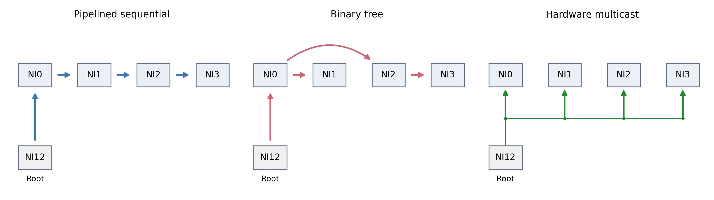
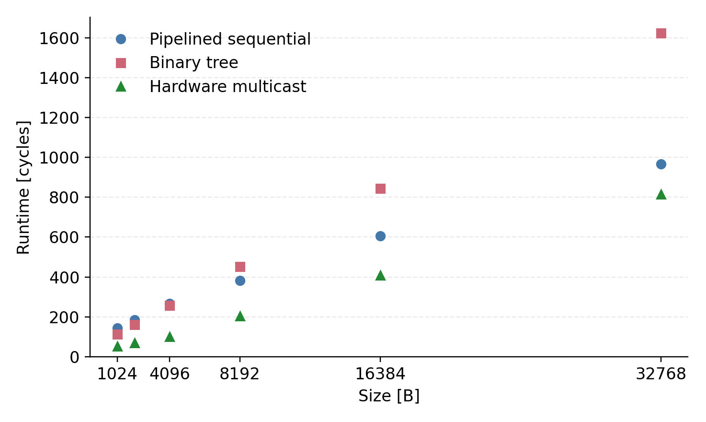
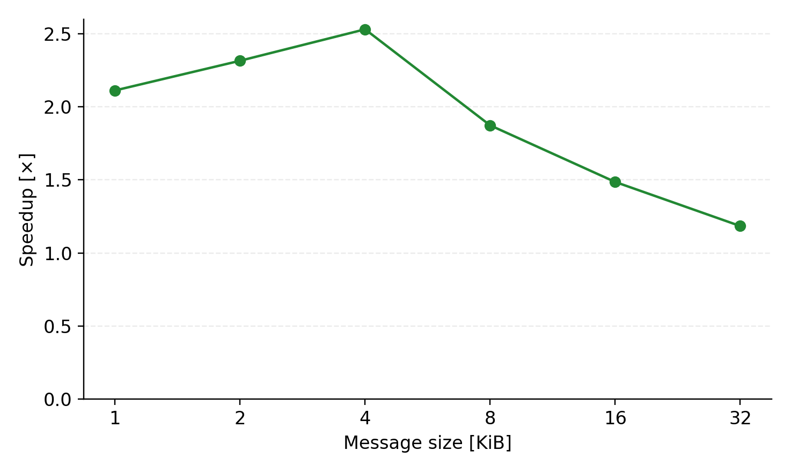
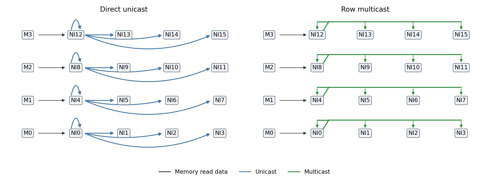
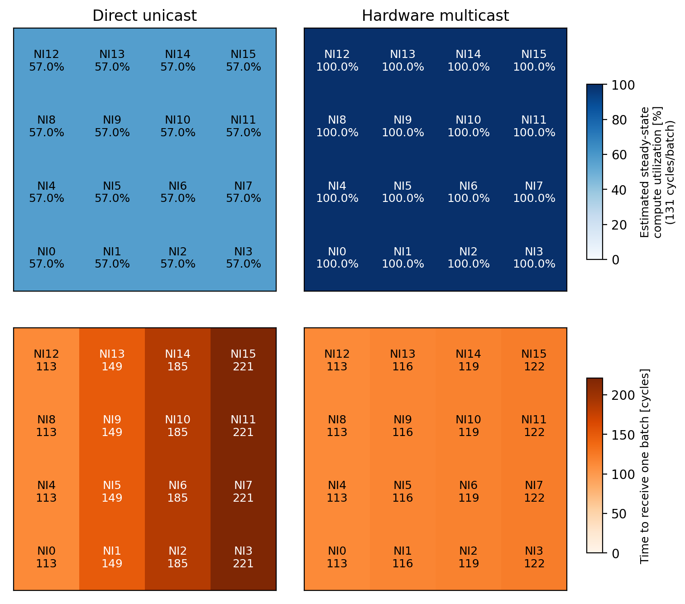
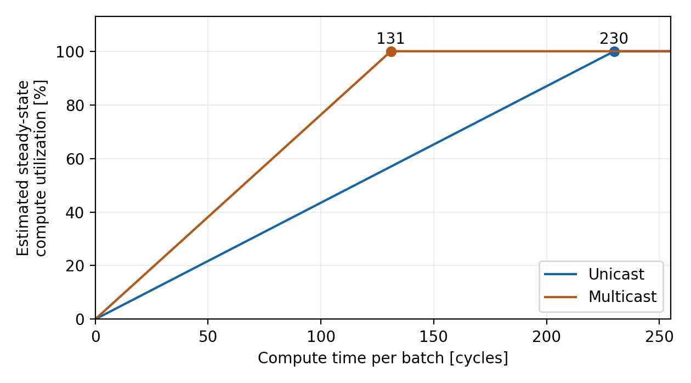

# Multicast 量測場景與結果

單列分發已完成 6 種資料量、33 個有效案例。四列記憶體供料已完成 2 KiB 的 unicast 與 multicast 量測。2D 全網 broadcast 待測。

### 圖表出處

| 本報告圖 | 論文依據與本案繪製範圍 |
|---|---|
| 單列 runtime | 依 [Collective NoC Fig. 5(a)，PDF 第 8 頁](https://arxiv.org/pdf/2603.26438v2#page=8)。X 為線性 Size [B]，Y 為 Runtime [cycles]。圖點取自本平台 seq、tree、hw 實測，2048 B 有量測點。原圖另有模型曲線。 |
| 單列 speedup | [§4.2.2](https://arxiv.org/html/2603.26438v2#S4.SS2.SSS2) 定義相對較快 seq/tree 的加速比。獨立畫成 message size 對 speedup 的曲線是本案補充呈現。 |
| 單列資料流 | [Fig. 4](https://arxiv.org/pdf/2603.26438v2#page=7) 以 DMA 發起者、傳輸順序及 barrier 表示三種軟體排程。本報告依實際來源、收件者畫 seq、tree 與 hw 的邏輯資料流，箭頭不表示傳輸耗時。 |
| 四列資料流 | 依本案指定的四列供料場景與實際 NI 座標繪製。[FlooNoC Fig. 11(a)](https://arxiv.org/html/2409.17606v2#S7.SS1) 提供按列存取邊界記憶體的參照。 |
| 四列利用率曲線 | X 為假設每批計算拍數，Y 為推估計算利用率。雙緩衝重疊原理引用 [Collective NoC Eq. 7](https://arxiv.org/html/2603.26438v2#S4.SS3.SSS1)，這組座標軸與百分比公式是本案對供料量測的推算。 |
| 逐節點 heatmap | X、Y 表示本平台 mesh 欄、列，NI 編號為 4y+x。上排色階為本案模型估值，下排為實測單批收齊時間。以 NI3 的 131 拍作比較基準及上下排配置均為本案選擇。[FlooNoC Fig. 11](https://arxiv.org/html/2409.17606v2#S7.SS1) 的空間圖量測其他指標。 |

## 1. 單列分發

### 場景與條件

比較 pipelined sequential forwarding（seq）、binary-tree forwarding（tree）與 hardware multicast（hw），將同一份資料分發到相同收件者。比較方式依據 [collective 論文 §4.2.2、Fig.4／5](https://arxiv.org/html/2603.26438v2#S4.SS2.SSS2)。

箭頭表示 payload 流向。

| 方法 | 資料流 |
|---|---|
| seq | NI12 → NI0 → NI1 → NI2 → NI3，以 batch 沿鏈路傳遞 |
| tree | NI12 → NI0，NI0 → NI2，最後 NI0 → NI1 與 NI2 → NI3 並行 |
| hw | NI12 以硬體 multicast 將資料送至 NI0、NI1、NI2、NI3 |



每波以先前一波的所有 source B 完成為依賴。中繼 source 從實際 device memory 取得已收到的資料後轉送。各 device memory 起始為空，預期資料僅載入 checker。

| 項目 | 本次設定 |
|---|---|
| 平台 | 4×4 mesh，每 node 配置 AXI source VIP、NI（NMU＋NSU）、REQ／RSP／DAT router、AXI device VIP |
| AXI、NoC clock frequency | 1 GHz |
| Root／收件者 | NI12 (0,3) → row 0 的 NI0–NI3 |
| Message size | 1、2、4、8、16、32 KiB，每個收件者收到完整的一份 |
| Seq batch size | 從 1 KiB 起按兩倍遞增至該 message size，比較所有候選，取 runtime 最短者 |
| 交易 | 512-bit AXI writes，ID 0，測試程式的 outstanding 上限為 16。HW 每筆 multicast burst 都等來源端 B 回應才發下一筆，實際最多一筆 outstanding |

論文的 pipelined sequential 由接收 cluster 的 DMA 向左鄰讀取。Tree 先從 memory tile 取資料再逐層轉送。本平台三種方法都由 AXI VIP 發起寫入，訊息起始於 NI12，波次間由 testbench 同步。單列結果未計入 memory fetch、CPU、DMA 或硬體 barrier 指令成本。[作者的 benchmark](provenance/reference/multicast_benchmark.c) · [原始 batch 範圍](provenance/reference/experiments.py) · [版本與 hash](provenance/reference/evidence.json)

### 量測起訖

Runtime 從 NI12 首次拉高 AWVALID，到最後一筆必要寫入回應在來源端完成 B handshake（BVALID 與 BREADY 同時有效）。Readback 在計時結束後執行。論文的起點與終點分別是第一筆 DMA transfer 開始與最後一筆 DMA transfer 完成。

```text
Runtime [cycles] = (t_last_required_B − t_root_AWVALID) / Tclk
Tseq(size) = min(runtime of seq over eligible batch sizes)
Tsw = min(Tseq, Ttree)
Speedup = Tsw / Thw
```

所有方法使用相同的事件定義，不加 1 cycle。Seq 的 batch 候選來自保存的公開 benchmark，例如 2 KiB message 對應 1 KiB、2 KiB 兩個候選。

### 結果



| 每個收件者的資料量 | 最佳 seq batch | Seq [cycles] | Tree [cycles] | HW [cycles] | 相對較快 seq/tree 排程的加速比 |
|---|---:|---:|---:|---:|---:|
| 1 KiB | 1 KiB | 144 | 114 | 54 | 2.11× |
| 2 KiB | 1 KiB | 186 | 162 | 70 | 2.31× |
| 4 KiB | 2 KiB | 266 | 258 | 102 | 2.53× |
| 8 KiB | 2 KiB | 382 | 453 | 204 | 1.87× |
| 16 KiB | 4 KiB | 606 | 843 | 408 | 1.49× |
| 32 KiB | 4 KiB | 966 | 1623 | 816 | 1.18× |



32 KiB 的 HW 傳輸拆成 8 筆 4 KiB burst，相鄰兩筆 AW handshake 相隔 102 拍，整批耗時 816 拍。同一資料量下，tree 的 root 在連續 8 拍送出全部 8 筆 AW。32 KiB 的 1.18× 包含這項發送政策的影響。[HW 交易紀錄](results/row-hw-32kib/tables/transactions.csv) · [Tree 交易紀錄](results/row-tree-32kib/tables/transactions.csv)

本平台單列加速比為 1.18–2.53×。論文 Fig. 5(a) 報告 2.3–3.2×，其 DMA、同步方式與計時邊界如上所述。Fig. 5(c) 的 5.3× 是 4×4 全網 broadcast 的幾何平均。[Collective NoC §4.2.2](https://arxiv.org/html/2603.26438v2#S4.SS2.SSS2)

## 2. 四列記憶體供料

### 場景與條件



每列左端節點從自己的記憶體讀取一批資料，再分發給**同列全部四個節點，包含自己**。例如 NI0 讀取 M0 後，NI0、NI1、NI2、NI3 各收到一份。四列同時執行，共 16 個收件節點。

- **Unicast**　每個 burst 分別寫入四個目的地。圖中的藍色迴圈表示寫入分發節點自己的目的緩衝區。
- **Multicast**　每個 burst 只發一筆整列 multicast，由硬體將資料交給四個目的地，包含本地端。

| 條件 | 設定 |
|---|---|
| 記憶體首拍 | 使用固定延遲 AXI memory model。Memory 端從接受 AR 到首個 R handshake 實測 29 拍，取自 DDR4-2400 已預充電 bank 開列的 $t_\mathrm{RCD}+t_\mathrm{CL}$（約 28.32 ns）。 |
| Burst 回傳 | 每列每批 2 KiB，共 32 個 64 B beats。首拍後每埠每拍回傳 64 B，1 GHz 下相當於 AXI 模型在 burst 期間的 64 GB/s。 |
| 換批 | 各來源收到最後一拍 R 後才開始分發。四列等最後一筆來源 B handshake 才共同啟動下一批。 |
| 取樣 | 每個模式跑四批，seed 1。從 0 編號，取批 1、2 的收齊延遲與 1→2、2→3 的穩態間隔。 |

按列配置邊界記憶體可對照 FlooNoC Fig. 11(a)，該圖量的是 HBM bandwidth utilization。四列各讀一批、各自分發給同列四個節點是本案的場景。[FlooNoC §VII-A](https://arxiv.org/html/2409.17606v2#S7.SS1) · [DDR4 首拍設定依據](https://raw.githubusercontent.com/gem5/gem5/stable/src/python/gem5/components/memory/dram_interfaces/ddr4.py)

### 量測起訖與利用率模型

**Time to receive one batch [cycles]** 回答「四列開始預取後，這個節點到第幾拍才拿齊 2 KiB？」起點是該批的共同預取起點，終點是目的端接受最後一個有效 W beat 的時脈上升緣（WVALID、WREADY、WLAST 同時有效）。時間包含記憶體取料與列內分發。分發節點自己也用相同的目的端事件計時。

**Estimated steady-state compute utilization [%]** 回答「連續處理多批資料時，每 100 拍有幾拍可用來計算？」假設每個節點每批需要 $C$ 拍計算，雙緩衝允許計算當批時預取下一批。$C$ 是給定值，供料時間由 VCS 實測。估算排除首次填充與最後排空，並假設計算不會額外占用供料資源。

- **全網曲線**使用相鄰兩次共同預取起點之差 $P_k$。每輪需時 $\max(C,P_k)$，故 $U(C)=100\,KC/\sum_k\max(C,P_k)$。本批 $K=2$。
- **逐節點 heatmap** 使用同一節點連續兩批收齊資料的間隔，代入同一公式。本次分發順序與各節點延遲逐批重複，因此每個節點的收件間隔恰好等於全網預取間隔。

雙緩衝下計算與通訊重疊的原理對應 collective 論文 Eq. 7。該文的 SUMMA 包含 A 沿列與 B 沿欄分發，本場景只量列內供料，並用供料時間估算可持續的計算比例。[Collective NoC §4.3.1](https://arxiv.org/html/2603.26438v2#S4.SS3.SSS1)

### 結果

| 方法 | x=0 收齊 [cycles] | x=1 收齊 [cycles] | x=2 收齊 [cycles] | x=3 收齊 [cycles] | 相鄰預取起點間隔 [cycles] |
|---|---:|---:|---:|---:|---:|
| Direct unicast | 113 | 149 | 185 | 221 | 230 |
| Hardware multicast | 113 | 116 | 119 | 122 | 131 |



上排以 NI3 的 multicast 收件間隔為基準，固定每批計算 **131 拍**。Multicast 每隔 131 拍送達下一批，估算利用率為 100%。Unicast 每隔 230 拍送達下一批，每輪計算 131 拍、等資料 99 拍，利用率為 **57.0%**。

下排顯示同一批的實測延遲。Multicast 的 NI0 在第 113 拍收齊，NI3 在第 122 拍收齊。NI3 每批都晚 9 拍收到資料，但它兩次收齊之間仍相隔 131 拍。兩種方法在最遠端收齊後，都再過 9 拍收到最後一筆來源 B 回應並啟動次批。



若每批計算 150 拍，unicast 的穩態利用率為 65.2%，multicast 為 100%。[逐節點 heatmap 數值](tables/node-utilization.csv) · [逐批收齊時間戳](tables/row-feed.csv) · [利用率曲線數值](tables/utilization.csv)

## 3. 結果與重現

- **單列分發**沿用 VCS build 90ac74a00ad8，33 例包含起初的 2 KiB 四例與後續 29 例。[2 KiB 起步紀錄](provenance/preparation.json) · [33 例完整紀錄](provenance/measurement.json) · [各案例與 run 路徑](tables/points.csv) · [加速比](tables/speedup.csv)
- **四列供料**的兩個正式 run 各自保存輸入、command、source/config hash、FSDB 與 validation。[Direct unicast](results/feed-unicast-ddr) · [Hardware multicast](results/feed-multicast-ddr)
- **繪圖**所用程式已隨結果保存。以下在工作站 repo 根目錄執行，讀取既有量測資料。[繪圖程式快照](provenance/plot-performance.py)

~~~sh
cd /home/mingwei/noc_rtl
# 單列 runtime、speedup 與資料流圖
make -C sim perf_multicast_plot
# 四列利用率曲線與逐節點 heatmap
export PYTHONPATH="$PWD/build/perf_plot_deps/site-packages:$PWD/dv/scripts"
export MPLCONFIGDIR="$PWD/build/perf_plot_deps/cache"
python3 -B performance/multicast/provenance/plot-performance.py --row-feed-heatmap performance/multicast
~~~
