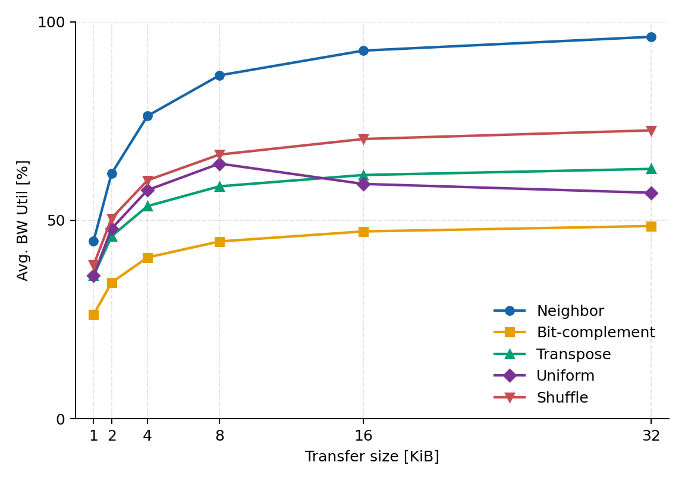

# 4×4 mesh read performance

在 4×4 mesh 上比較五種 traffic pattern 的 wide-read bandwidth utilization 與 narrow-read latency。

## Workload and traffic patterns

- **平台**　AXI 介面與晶片內網路（NoC）的時脈都是 1 GHz，1 cycle 等於 1 ns。每個節點有一個發出請求的 AXI source VIP、一個提供資料的 AXI device VIP（記憶體模型）、一個連接 AXI 與 NoC 的網路介面（NI，含 NMU 與 NSU），以及一個負責轉送封包的 router（REQ、RSP、DAT）。
- **大筆讀取（wide reads）**　資料介面寬 512 bits，每個 cycle 最多回傳 64 B。每個來源分別讀取 1、2、4、8、16、32 KiB（1 KiB = 1024 B），比較傳輸量增加時能用到多少頻寬。
- **小筆讀取（narrow reads）**　每個來源讀取 32 筆，每筆 8 B，只需一個 R beat 傳送資料。這組測試量的是從讀取請求被接受到收到資料，一共等了多少個 cycle。
- **論文對應**　採用 FlooNoC Fig. 8 的兩種比較方式：以每個來源的傳輸量對照 wide 存取的平均頻寬利用率，以注入率對照 narrow 存取的平均延遲。本次選取其中五種合成流量。論文使用 8×4 compute mesh，本案在 source AXI 介面量測，未加入原文繪圖時的 7-cycle cluster 延遲。[論文 Fig. 8](https://arxiv.org/pdf/2409.17606v2#page=9) · [原文繪圖程式](runs/uniform-32kib/provenance/reference/paper-source/scripts/plots.py)

節點由左到右編號，每列 4 個。來源座標 $(x,y)$ 對應節點 $s=4y+x$，目的地座標 $(x_d,y_d)$ 對應節點 $d=4y_d+x_d$。例如 Node 1 在 $(1,0)$。

| Pattern | Destination selection | Mapping |
| --- | --- | --- |
| Neighbor | Next node to the right, wrapping to the first column | $(x_d,y_d)=((x+1)\bmod4,y)$ |
| Bit-complement | Complement both coordinates (e.g., node 0 reads node 15) | $(x_d,y_d)=(3-x,3-y)$ |
| Transpose | Swap x and y (e.g., node 1 reads node 4) | $(x_d,y_d)=(y,x)$ |
| Uniform | One random remote destination per source, fixed across reads | $d_s\sim\mathcal{U}(\{0,\ldots,15\}\setminus\{s\})$ |
| Shuffle | Shuffle node IDs (e.g., node 1 reads node 8) | $q=4x+y,\quad d=2(q\bmod8)+\lfloor q/8\rfloor$ |

Uniform 使用固定亂數種子 42。選定目的地後，改變資料量或請求頻率都沿用同一組配對。

## Wide reads: average bandwidth utilization

各來源同時讀取 1–32 KiB，量測五種 traffic pattern 能使用多少 DAT 回傳頻寬。

圖 1　16 個來源同時讀取，每個來源讀 1–32 KiB。

- Neighbor 的平均頻寬利用率從 44.8% 升至 96.2%。以 node 3 讀 node 0 為例，資料沿 0 → 1 → 2 → 3 向右回傳，同列其餘三條回傳流各向左走一段，各自獨用單向鏈路。
- Bit-complement 在 32 KiB 時為 48.6%。每條回傳路徑都有一段與另一條資料流共用。
- 每個來源的頻寬利用率以收到的資料量除以自己的完成時間，再除以每個 cycle 可接收的 64 B。例如平均收到 32 B/cycle，利用率為 50%。表內數值取 16 個來源的平均。各來源從 reset 解除後第一個取樣上升緣量到自身讀取完成，起訖兩個 cycle 都算入。

**平均頻寬利用率 [%]**

| Pattern | 1 KiB | 2 KiB | 4 KiB | 8 KiB | 16 KiB | 32 KiB |
| --- | --- | --- | --- | --- | --- | --- |
| Neighbor | 44.82 | 61.79 | 76.31 | 86.53 | 92.77 | 96.24 |
| Bit-complement | 26.23 | 34.31 | 40.65 | 44.67 | 47.20 | 48.56 |
| Transpose | 36.06 | 46.00 | 53.58 | 58.57 | 61.42 | 62.96 |
| Uniform | 36.06 | 47.90 | 57.62 | 64.29 | 59.17 | 56.94 |
| Shuffle | 38.70 | 50.52 | 60.09 | 66.57 | 70.49 | 72.66 |

[完整精度與 run 索引](tables/bandwidth.csv)

### Link sharing and bandwidth utilization

每條 flow 的資料都要走完整條回傳路徑，因此回傳速率受沿途可分得頻寬最少的鏈路限制。對每個 source $i$，找出其路徑上共用 flow 數最多的單向鏈路，稱為瓶頸鏈路，將該鏈路上的 flow 數記為 $k_i$。計數包含自己的 flow，以及路徑上的 router 間鏈路與 NI 進出網路的鏈路。

假設共用同一條鏈路的 flows 均分頻寬，source $i$ 可用的峰值頻寬比例估為 $1/k_i$：

- $k_i=1$：獨用鏈路，可用 100%。
- $k_i=2$：兩條 flow 共用，各可用 50%。
- $k_i=3$：三條 flow 共用，各可用約 33%。

表中的 **Estimated utilization** 是所有 source 的估計值取平均。本次共有 $N=16$ 個 source：

$$
\hat U=\frac{100\%}{N}\sum_{i=1}^{N}\frac{1}{k_i}.
$$

本次五種 traffic pattern 的 $k_i$ 只出現 1、2、3。表中的 $n_1$、$n_2$、$n_3$ 分別表示瓶頸鏈路由 1、2、3 條 flow 使用的 **source 數量**，所以同一個平均值也可以按組計算：

$$
\hat U=\frac{100\%}{16}\left(n_1+\frac{n_2}{2}+\frac{n_3}{3}\right).
$$

- **Neighbor**：16 個 source 都獨用沿途鏈路，$n_1=16$、$n_2=n_3=0$，估計利用率為 **100%**。
- **Bit-complement**：每個 source 的瓶頸鏈路都有兩條 flow 共用，$n_2=16$、$n_1=n_3=0$，估計利用率為 **50%**。

最右欄是每個 source 讀取 32 KiB 的實測利用率。

| Pattern | 1 flow ($n_1$) | 2 flows ($n_2$) | 3 flows ($n_3$) | Estimated utilization [%] | Measured utilization [%] |
| --- | ---: | ---: | ---: | ---: | ---: |
| Neighbor | 16 | 0 | 0 | 100.00 | 96.24 |
| Shuffle | 8 | 8 | 0 | 75.00 | 72.66 |
| Transpose | 6 | 4 | 6 | 62.50 | 62.96 |
| Uniform | 2 | 11 | 3 | 53.13 | 56.94 |
| Bit-complement | 0 | 16 | 0 | 50.00 | 48.56 |

- 32 KiB 時，Neighbor 的實測利用率為 Bit-complement 的 1.98 倍。
- **Shuffle 排在第二**　8 個來源全程獨用鏈路，另外 8 個來源沿途最多兩條 flow 共享。固定均分估計是 $(8×100\%+8×50\%)/16=75\%$，實測為 72.66%。
- **Transpose、Uniform 完成較晚，平均頻寬仍較高**　兩者都有三條 flow 共用的鏈路，整批完成時間分別為 1564 和 1601 cycles，比 Bit-complement 的 1064 cycles 久。但 Transpose 有 6 個來源全程獨用鏈路，這 6 個的平均利用率達 96.85%。Uniform 也有 2 個這樣的來源，平均達 96.24%，另有 11 個最多兩條共享的來源平均達 53.72%。這些先收完的來源拉高了整體平均。

這個估算只考慮 link contention。實測值也可能受 packet overhead、arbitration、pipeline 與 flow control 影響；此處未分別量測各因素的占比。實際傳輸有先後，一條 flow 傳完，其他 flow 就可能用到空出的頻寬。模型也省略了開頭等待資料的時間。因此單一來源的利用率可能高於或低於估計。例如 Uniform 三條共享組估計為 33.33%，實測平均為 42.57%。 [配對與 DAT 路徑](provenance/bandwidth-comparison.json) · [鏈路容量分析背景，Towles 等人 §2.3](https://web.stanford.edu/~boyd/papers/pdf/obliv_route.pdf)

### Uniform traffic: bandwidth utilization at 8 and 16 KiB

8、16、32 KiB 分別拆成 2、4、8 個 burst。每個 burst 是一筆以多個 R beats 回傳資料的 AXI 讀取。三種大小的平均利用率依序為 64.29%、59.17%、56.94%。

以 Node 1 讀取 device 0 為例：

- **8 KiB**　device 0 連續回傳 Node 1 的兩個 burst。Node 1 共花 146 cycles，利用率為 87.7%。
- **16 KiB**　device 0 在回傳 Node 1 的第 3 和第 4 個 burst 前，各先回傳 Node 8 的兩個 burst。Node 1 收到的資料加倍，花的時間卻增至 530 cycles，利用率降至 48.3%。

同樣從 8 增至 16 KiB，Node 10 也從 87.7% 降至 52.4%。光是這兩個來源，就讓 16 個來源的平均下降約 4.67 個百分點。合計所有來源後，平均下降 5.12 個百分點。 [8 KiB 交易](runs/uniform-8kib/tables/transactions.csv) · [16 KiB 交易](runs/uniform-16kib/tables/transactions.csv)

### Completion time and link capacity at 32 KiB

- 讀取資料在網路內依 XY 路由轉送，先沿 x 方向走，再沿 y 方向走。這裡看整個網路，找出共用同一條單向鏈路的最大 flow 數 $F_{\max}$。
- 一條 flow 有 512 個 64 B data beats 要送。若最忙鏈路承載兩條 flow，光是在那條鏈路送完兩份資料就至少要 1024 cycles。這就是表中的「容量下限」。

$$
T_{\min}=F_{\max}\times\frac{32\times1024\ \mathrm{B}}{64\ \mathrm{B/cycle}}
=512F_{\max}\ \mathrm{cycles}.
$$

五組測試的 16 個來源都在同一個 cycle 送出第一筆讀取位址並獲接受（AR handshake）。表中的整批計時從此事件前一個 cycle 開始，到最後一個來源收到最後一個 data beat（R handshake 且 RLAST 有效）為止，含起訖兩個 cycle。

表中差額取實測完成時間減去容量下限，百分比以容量下限為基準。

| Pattern | Max. flows per link | Lower bound [cycles] | Completion time [cycles] | Excess [cycles] | Excess [%] |
| --- | ---: | ---: | ---: | ---: | ---: |
| [Neighbor](runs/32kib/tables/summary.json) | 1 | 512 | 538 | 26 | 5.1 |
| [Bit-complement](runs/bit-complement-32kib/tables/summary.json) | 2 | 1024 | 1064 | 40 | 3.9 |
| [Transpose](runs/transpose-32kib/tables/summary.json) | 3 | 1536 | 1564 | 28 | 1.8 |
| [Uniform](runs/uniform-32kib/tables/summary.json) | 3 | 1536 | 1601 | 65 | 4.2 |
| [Shuffle](runs/shuffle-32kib/tables/summary.json) | 2 | 1024 | 1049 | 25 | 2.4 |

- **Neighbor 與 Bit-complement**　最忙鏈路分別承載 1 與 2 條 flow。Bit-complement 的整批完成時間為 Neighbor 的 1.98 倍。
- **Uniform**　來源 1、3、8 都讀取 device 0，使該 NI 的 DAT 注入鏈路承載 3 條 flow。只看 router 間鏈路會得到 2。

[單向鏈路負載圖](figures/bandwidth-bottleneck.png) · [五組鏈路負載](tables/bandwidth-comparison.csv)

### Router contention at 32 KiB

- 上排是讀取請求（REQ），下排是回傳讀取資料的 virtual channel （DAT read VC1）。每格代表一個 router，編號為 $4y+x$。同一排的五種 pattern 共用色階。
- 格內數字是「有多少個 cycle 發生競爭」。同一個 cycle 若有兩個以上的 input port 要用同一個 output port 的同一通道，就算 1 cycle。即使 router 的兩個 output port 同時發生競爭，這個 router 也只記 1 cycle。要知道某筆讀取因此多等了多少個 cycle，還得追蹤那筆讀取的時序。
- **DAT 熱點**　Neighbor 各 router 均為 0。Bit-complement 的最高值在 Router 1、2、13、14（1013 cycles），Transpose 在 Router 2、13（1501 cycles），Uniform 在 Router 3（881 cycles），Shuffle 在 Router 6、9（1021 cycles）。

[逐 router 計數](tables/contention-32kib.csv) · [Bit-complement 的路徑與 request 時序範例](figures/contention-example.png) · [FSDB 與匯出指令](provenance/contention-32kib.json)

## Narrow reads: average read latency

改變注入率，量測每筆 8 B 讀取從來源 AR handshake 到第一個 R handshake 的平均延遲。

每個來源發出 32 筆讀取。

- 全網一次只讀一筆時，Neighbor 平均需 14 cycles，Uniform 需 15.63 cycles。
- 設定注入率為 0.5 時，Neighbor 仍為 14 cycles，Uniform 增至 26.30 cycles。

### Configured injection rate and measured AXI request rate

設定注入率 $r$ 控制來源發出下一筆請求前要等多久。當 $r>0$，測試程式對每筆請求先從 0～100 等機率抽一個整數 $k$。若 $k<100r$，就停止抽籤。每失敗一次，該筆請求的發送延遲就增加 1 cycle。以下公式只算一次抽籤通過的機率。圖 2 橫軸標示使用者設定的 $r$；AXI 實際接受率另由 AR handshake 計算。

$$
p(r)=\frac{\#\{k\in\{0,\ldots,100\}:k<100r\}}{101}
=\frac{\lceil100r\rceil}{101}.
$$

- 設定 **0.5** 時，抽到 0～49 都通過，機率是 $50/101$。這會產生長短不同的請求間隔。
- 設定 **0.001 或 0.01** 時，都只有抽到 0 才通過。這兩個橫軸位置對應同一種抽籤條件。
- 圖上的 **0（zero-load）** 是獨立測試模式。全網一次只發一筆，收到回應後才允許下一筆，藉此量出單筆讀取在沒有其他交易競爭時的延遲。[發送程式與隔離機制](runs/neighbor-zero/provenance/source/dv/env/seq_lib/ni_pattern_sequence.svh)

實際注入率按來源端的 AXI AR handshake 計算：

- 在 rising clock edge，ARVALID 與 ARREADY 同時為 1，表示介面接受一筆讀取。只有 ARVALID 為 1 時，請求仍在等候。
- 以設定 0.5 的 Neighbor、node 0 為例，第 1 筆和第 32 筆分別在 12.5 ns 和 78.5 ns 被接受。在 1 GHz 下，兩者相隔 66 cycles。以第一筆為起點，這段時間新增 31 筆，接受率為 0.4697 筆／cycle。
- 每個來源都按自己的首末兩次 AR handshake 計算接受率，報告中的接受率取 16 個來源的平均。

設定 0.5 時，五組實測皆為 **0.49795 筆／來源／cycle**，平均約每 2 cycles 接受一筆。注入前的等待會影響這個速率。下文的讀取延遲從 AR 已被接受的那個 cycle 才開始計算。[逐來源 AR 時間戳與接受率](tables/latency-sources.csv) · [報表計算程式](provenance/performance.py)

### Zero-load latency for adjacent tiles

node 0 讀取相鄰 node 1 的單筆 8 B 資料。從來源 AR handshake 到來源 R handshake，讀取延遲為 **13 cycles**。

- **請求去程：6 cycles**。從來源接受讀取位址，到目的端接受讀取位址。來源 NI、兩個 REQ router 合計、目的地 NI 各用 2 cycles。
- **記憶體讀取：1 cycle**。目的端接受讀取位址後，下一個 cycle 回傳資料。
- **資料回程：6 cycles**。目的地 NI 用 2 cycles，兩個 RSP router 合計 2 cycles，來源 NI 收到回應後再經 2 cycles 完成來源 R handshake。

本地讀取需 11 cycles。單程每增加一個 hop，請求與回應各增加 1 cycle，因此單程距離為 $h$ hops 時，無等待延遲為 $L_0(h)=11+2h$ cycles。五種 pattern 的 2,560 筆 zero-load 讀取均符合此式。[逐段時間戳](../tile-to-tile/tables/tile-to-tile-breakdown.csv) · [Zero-load 量測](tables/latency.csv)

### Additional read latency at an injection setting of 0.5

五種 pattern 的實際接受率相同。除 hop 數外，下表單位均為 cycles。

| Pattern | Avg. one-way hops | Predicted zero-load latency | Measured zero-load latency | Loaded latency | Additional latency |
| --- | ---: | ---: | ---: | ---: | ---: |
| Neighbor | 1.5 | 14 | 14 | 14.000 | 0.000 |
| Bit-complement | 4 | 19 | 19 | 25.494 | 6.494 |
| Transpose | 2.5 | 16 | 16 | 25.234 | 9.234 |
| Uniform | 2.3125 | 15.625 | 15.625 | 26.299 | 10.674 |
| Shuffle | 2 | 15 | 15 | 16.912 | 1.912 |

以 Uniform 這一列為例：

- **Avg. one-way hops**：由 16 組來源與目的地的座標算出各自的單程 hop 數，再取平均，得到 2.3125。
- **Predicted zero-load latency**：用上一節的路徑延遲公式推算，$11+2\times2.3125=15.625$ cycles。
- **Measured zero-load latency、Loaded latency**：兩次測試都從來源 AR handshake 量到第一個 R handshake，以 cycles 記錄每筆延遲。每次測試各有 16 個來源、每個來源 32 筆，因此這兩欄各自取 512 筆讀取的平均。全網一次只讀一筆時量得 **15.625** cycles，設定 0.5 時量得 **26.299** cycles。
- **Additional latency**：用 Loaded latency 減去 Predicted zero-load latency。Uniform 平均多等 10.674 cycles。這是整筆讀取增加的時間；要定位等待發生在哪個 router 或記憶體介面，還需要逐段時間戳。

Uniform 在無等待時比 Bit-complement 快 3.375 cycles；加入相同負載後，Uniform 的額外等待較長，平均讀取延遲反而高約 0.8 cycle。[完整 55 個量測點](tables/latency.csv)

## Data sources

- [85 次量測的索引](tables/inventory.csv) · [版本與檔案雜湊](provenance/inventory.json) · [場景設定](runs/uniform-16kib/config/paper-conditions.json)
- [頻寬與延遲計算程式](runs/uniform-16kib/provenance/source/dv/scripts/run.py) · [鏈路負載推導](provenance/bandwidth-comparison.json)
- [Neighbor 與 Bit-complement 的逐 node 分段延遲](figures/node-stages.png) · [逐交易時間戳](tables/node-timeline-transactions.csv)
