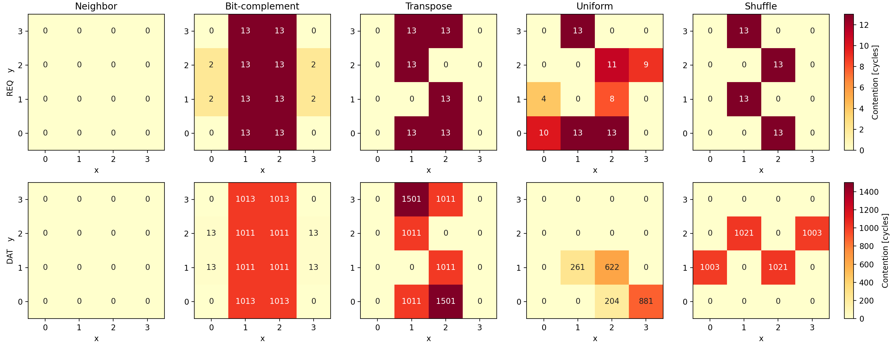

# 4×4 Mesh 讀取效能

16 個節點排成 4 列、4 行。每個節點都能發出讀取請求，也能回傳記憶體資料。文中的「來源」指發出請求的節點，「目的地」指提供資料的節點。讀取請求走 REQ 網路，大筆讀取的資料走 DAT 網路回到來源，小筆讀取的資料走 RSP 網路回到來源。五種 traffic pattern 指定每個來源要向哪個節點讀資料。

## 量測條件

- **平台**　AXI 介面與晶片內網路（NoC）的時脈都是 1 GHz，一拍（cycle）等於 1 ns。每個節點有一個發出請求的 AXI source VIP、一個提供資料的 AXI device VIP（記憶體模型）、一個連接 AXI 與 NoC 的網路介面（NI，含 NMU 與 NSU），以及一個負責轉送封包的路由器（router，含 REQ、RSP 與 DAT）。
- **大筆讀取（wide reads）**　資料介面寬 512 bits，每拍最多回傳 64 B。每個來源分別讀取 1、2、4、8、16、32 KiB（1 KiB = 1024 B），比較傳輸量增加時能用到多少頻寬。
- **小筆讀取（narrow reads）**　每個來源讀取 32 筆，每筆 8 B，只需一拍傳送資料。這組測試量的是從讀取請求被接受到收到資料，一共等了幾拍。
- **論文對應**　沿用 FlooNoC Fig. 8 的五種 traffic pattern、wide 頻寬與 narrow 延遲。論文使用 8×4 compute mesh，本案在 source AXI 介面量測，未加入原文繪圖時的 7-cycle cluster 延遲。[論文 Fig. 8](https://arxiv.org/pdf/2409.17606v2#page=9) · [原文繪圖程式](runs/uniform-32kib/provenance/reference/paper-source/scripts/plots.py)

節點由左到右編號，每列 4 個。來源座標 $(x,y)$ 對應節點 $s=4y+x$，目的地座標 $(x_d,y_d)$ 對應節點 $d=4y_d+x_d$。例如 Node 1 在 $(1,0)$。

| Pattern | 如何選擇讀取目的地 | 配對公式 |
|---|---|---|
| Neighbor | 讀同一列右方一格，最右端的節點讀該列最左端 | $(x_d,y_d)=((x+1)\bmod4,y)$ |
| Bit-complement | 將兩個座標都反轉，例如 Node 0 讀 Node 15 | $(x_d,y_d)=(3-x,3-y)$ |
| Transpose | 交換 x 與 y，例如 Node 1 讀 Node 4 | $(x_d,y_d)=(y,x)$ |
| Uniform | 每個來源從其餘 15 個節點中隨機選一個 | $d_s\sim\mathcal{U}(\{0,\ldots,15\}\setminus\{s\})$ |
| Shuffle | 按固定公式重新排列節點，例如 Node 1 讀 Node 8 | $q=4x+y,\quad d=2(q\bmod8)+\lfloor q/8\rfloor$ |

Uniform 使用固定亂數種子 42。選定目的地後，改變資料量或請求頻率都沿用同一組配對。

## Wide reads 的平均頻寬利用率 [%]

頻寬利用率回答的是「每拍最多能收 64 B，平均實際收到多少？」例如平均每拍收到 32 B，利用率就是 50%。先用各來源實際收到的資料量 $B_i$（bytes）和它花的時間分別計算，再取 16 個來源的平均。

$$
C_i=\left\lfloor\frac{t_{\mathrm{DONE},i}-t_{\mathrm{start},i}}{T_{\mathrm{clk}}}\right\rfloor+1,
\qquad
\mathrm{Avg.\ BW\ Util}=\frac{1}{16}\sum_{i=1}^{16}100\frac{B_i}{64C_i}
$$

$C_i$ 是來源 $i$ 的量測拍數。從 reset 解除後第一個取樣上升緣開始，到該來源完成讀取為止，首尾兩拍都算入。$T_{\mathrm{clk}}$ 為一拍的時間。

| Pattern | 1 KiB | 2 KiB | 4 KiB | 8 KiB | 16 KiB | 32 KiB |
| --- | --- | --- | --- | --- | --- | --- |
| Neighbor | 44.817927 | 61.793103 | 76.314363 | 86.532645 | 92.768028 | 96.244652 |
| Bit-complement | 26.229719 | 34.314027 | 40.646050 | 44.671174 | 47.198603 | 48.556448 |
| Transpose | 36.055250 | 45.997161 | 53.582848 | 58.567541 | 61.419472 | 62.955989 |
| Uniform | 36.060726 | 47.902016 | 57.622172 | 64.291842 | 59.172038 | 56.942737 |
| Shuffle | 38.702593 | 50.517336 | 60.089366 | 66.566632 | 70.492421 | 72.664915 |

[完整精度與 run 索引](tables/bandwidth.csv)

### 為何五種 pattern 的平均頻寬不同

32 KiB 若每拍收滿 64 B，512 拍就能收完。同樣的資料若花 1024 拍，該來源的利用率就是 50%。這裡每個來源各用自己的完成時間計算。後面的「整批完成時間」則要等到最後一個來源收完。

從目的地回到來源的資料流稱為一條 flow。沿每條回程路徑，數出哪一段單向連線（鏈路）有最多條 flow 共用，包括 NI 送入與接出網路的連線。若最忙的一段共有兩條 flow，並假設兩者固定均分頻寬，便估計該來源可用 1/2 的頻寬。下表按各來源沿途最多有 1、2 或 3 條 flow 共用分組，三組的來源數分別記為 $n_1,n_2,n_3$。

$$
\widehat U=\frac{100}{16}\left(n_1+\frac{n_2}{2}+\frac{n_3}{3}\right)\%.
$$

| Pattern | 獨用 $n_1$ | 兩條共享 $n_2$ | 三條共享 $n_3$ | 固定均分估計 [%] | 實測 Avg. BW Util [%] |
|---|---:|---:|---:|---:|---:|
| Neighbor | 16 | 0 | 0 | 100.00 | 96.24 |
| Shuffle | 8 | 8 | 0 | 75.00 | 72.66 |
| Transpose | 6 | 4 | 6 | 62.50 | 62.96 |
| Uniform | 2 | 11 | 3 | 53.13 | 56.94 |
| Bit-complement | 0 | 16 | 0 | 50.00 | 48.56 |

- **Neighbor 約為 Bit-complement 的兩倍**　Neighbor 的 16 條路徑都獨用鏈路。Bit-complement 的每條路徑都至少經過一條由兩個 flow 共享的鏈路，估計每個來源可用一半頻寬。實測比值為 $96.24/48.56=1.98$。
- **Shuffle 排在第二**　8 個來源全程獨用鏈路，另外 8 個來源沿途最多兩條 flow 共享。固定均分估計是 $(8×100\%+8×50\%)/16=75\%$，實測為 72.66%。
- **Transpose、Uniform 完成較晚，平均頻寬仍較高**　兩者都有三條 flow 共用的鏈路，最後一個來源分別花了 1564 和 1601 拍，比 Bit-complement 的 1064 拍久。但 Transpose 有 6 個來源全程獨用鏈路，這 6 個的平均利用率達 96.85%。Uniform 也有 2 個這樣的來源，平均達 96.24%，另有 11 個最多兩條共享的來源平均達 53.72%。這些先收完的來源拉高了整體平均。

固定均分用來估計五組的排序。實際傳輸有先後，一條 flow 傳完，其他 flow 就可能用到空出的頻寬。模型也省略了開頭等待資料的時間。因此單一來源的利用率可能高於或低於估計。例如 Uniform 三條共享組估計為 33.33%，實測平均為 42.57%。 [配對與 DAT 路徑](provenance/bandwidth-comparison.json) · [鏈路容量分析背景，Towles 等人 §2.3](https://web.stanford.edu/~boyd/papers/pdf/obliv_route.pdf)

### 為什麼 Uniform 從 8 KiB 開始下降？

8、16、32 KiB 分別拆成 2、4、8 個 burst。每個 burst 是一筆分多拍回傳資料的 AXI 讀取。三種大小的平均利用率依序為 64.29%、59.17%、56.94%。

以 Node 1 讀取 device 0 為例：

- **8 KiB**　device 0 連續回傳 Node 1 的兩個 burst。Node 1 共花 146 拍，利用率為 87.7%。
- **16 KiB**　device 0 在回傳 Node 1 的第 3 和第 4 個 burst 前，各先回傳 Node 8 的兩個 burst。Node 1 收到的資料加倍，花的時間卻增至 530 拍，利用率降至 48.3%。

同樣從 8 增至 16 KiB，Node 10 也從 87.7% 降至 52.4%。光是這兩個來源，就讓 16 個來源的平均下降約 4.67 個百分點。合計所有來源後，平均下降 5.12 個百分點。 [8 KiB 交易](runs/uniform-8kib/tables/transactions.csv) · [16 KiB 交易](runs/uniform-16kib/tables/transactions.csv)

## 32 KiB 讀取的完成時間與鏈路容量

- 讀取資料在網路內依 XY 路由轉送，先沿 x 方向走，再沿 y 方向走。這裡看整個網路，找出共用同一條單向鏈路的最大 flow 數 $F_{\max}$。
- 一條 flow 有 512 拍資料要送。若最忙鏈路承載兩條 flow，光是在那條鏈路送完兩份資料就至少要 1024 拍。這就是表中的「容量下限」。

$$
T_{\min}=F_{\max}\times\frac{32\times1024\ \mathrm{B}}{64\ \mathrm{B/cycle}}
=512F_{\max}\ \mathrm{cycles}.
$$

五組測試的 16 個來源都在同一拍送出第一筆讀取位址並獲接受（AR handshake）。表中的整批計時從這一拍的前一拍開始，到最後一個來源收到最後一拍資料（R handshake 且 RLAST 有效）為止，含首尾兩拍。

| Pattern | 最大 flow 數 | 容量下限 [cycles] | 實測完成時間 [cycles] | 超出下限 [cycles] | 超出下限 [%] |
|---|---:|---:|---:|---:|---:|
| [Neighbor](runs/32kib/tables/summary.json) | 1 | 1 × 512 = 512 | 538 | 26 | 5.1 |
| [Bit-complement](runs/bit-complement-32kib/tables/summary.json) | 2 | 2 × 512 = 1024 | 1064 | 40 | 3.9 |
| [Transpose](runs/transpose-32kib/tables/summary.json) | 3 | 3 × 512 = 1536 | 1564 | 28 | 1.8 |
| [Uniform](runs/uniform-32kib/tables/summary.json) | 3 | 3 × 512 = 1536 | 1601 | 65 | 4.2 |
| [Shuffle](runs/shuffle-32kib/tables/summary.json) | 2 | 2 × 512 = 1024 | 1049 | 25 | 2.4 |

- **Neighbor 與 Bit-complement**　最忙鏈路分別承載 1 與 2 條 flow。Bit-complement 的整批完成時間為 Neighbor 的 1.98 倍（1064／538）。
- **Uniform**　來源 1、3、8 都讀取 device 0，使該 NI 的 DAT 注入鏈路承載 3 條 flow。只看 router 間鏈路會得到 2。
- **與下限的差額**　以 $(T_{\mathrm{meas}}-T_{\min})/T_{\min}$ 計算，五組實測完成時間高出容量下限 1.8%～5.1%。

[單向鏈路負載圖](figures/bandwidth-bottleneck.png) · [五組鏈路負載](tables/bandwidth-comparison.csv)

### 32 KiB 的 router 競爭分布

- 上排是讀取請求（REQ），下排是回傳讀取資料的虛擬通道（DAT read VC1）。每格代表一個路由器，編號為 $4y+x$。同一排的五種 pattern 共用色階。
- 格內數字是「有幾拍發生競爭」。同一拍若有兩個以上的輸入要用同一輸出埠的同一通道，就算 1 拍。即使路由器的兩個輸出埠同時發生競爭，這個路由器也只記 1 拍。要知道某筆讀取因此多等了幾拍，還得追蹤那筆讀取的時序。
- **DAT 熱點**　Neighbor 各 router 均為 0。Bit-complement 的最高值在 Router 1、2、13、14（1013 拍），Transpose 在 Router 2、13（1501 拍），Uniform 在 Router 3（881 拍），Shuffle 在 Router 6、9（1021 拍）。

[逐 router 計數](tables/contention-32kib.csv) · [Bit-complement 的路徑與 request 時序範例](figures/contention-example.png) · [FSDB 與匯出指令](provenance/contention-32kib.json)

## Narrow reads 的平均延遲 [cycles]

每筆只讀 8 B，一拍就能傳完資料。圖的縱軸是從來源的讀取位址被接受（AR handshake）到來源收到資料（R handshake）隔了幾拍。圖的橫軸是測試程式設定的注入率。

### 注入率怎麼算？

**設定注入率** $r$ 控制來源發出下一筆請求前要等多久。當 $r>0$，測試程式對每筆請求先從 0～100 等機率抽一個整數 $k$。若 $k<100r$，就停止抽籤。每失敗一次，該筆請求的發送延遲就增加一拍。一次抽籤通過的機率為

$$
p(r)=\frac{\#\{k\in\{0,\ldots,100\}:k<100r\}}{101}
=\frac{\lceil100r\rceil}{101}.
$$

- 設定 **0.5** 時，抽到 0～49 都通過，機率是 $50/101$。這會產生長短不同的請求間隔。
- 設定 **0.001 或 0.01** 時，都只有抽到 0 才通過。這兩個橫軸位置對應同一種抽籤條件。
- 圖上的 **0（zero-load）** 是獨立測試模式。全網一次只發一筆，收到回應後才允許下一筆，藉此量出單筆讀取在沒有其他交易競爭時的延遲。[發送程式與隔離機制](runs/neighbor-zero/provenance/source/dv/env/seq_lib/ni_pattern_sequence.svh)

**實際注入率**用 AXI 已接受的請求計算，單位是「每個來源每拍接受幾筆」。每個來源有 32 筆 AR handshake，第一筆到最後一筆之間共有 31 個間隔。將 31 除以經過的拍數，再對 16 個來源取平均：

$$
r_i=\frac{31}{(t_{\mathrm{last\,AR},i}-t_{\mathrm{first\,AR},i})/T_{\mathrm{clk}}},
\qquad \bar r=\frac{1}{16}\sum_{i=1}^{16}r_i .
$$

設定 0.5 時，五組實測皆為 **0.49795 筆／來源／拍**，平均約每兩拍接受一筆。注入前的等待會影響這個速率。下文的讀取延遲從 AR 已被接受的那一拍才開始計算。[逐來源 AR 時間戳與接受率](tables/latency-sources.csv) · [報表計算程式](provenance/performance.py)

### 一筆讀取最快需要幾拍？

令 $h=|x_s-x_d|+|y_s-y_d|$，即從來源到目的地要跨過幾條相鄰路由器之間的鏈路。8 B 讀取的請求走 REQ，回傳資料走 RSP。以既有的相鄰節點波形為例，從來源 AR handshake 到來源 R handshake 共 **13 拍**：

| 階段 | 無等待時的拍數 |
|---|---:|
| 來源接受 AR，到 NI 將請求送入 REQ 網路 | 2 |
| REQ 從來源走到目的地 | $h+1$ |
| 目的地 NI 將請求送到記憶體介面 | 2 |
| 記憶體接受 AR，到回傳第一拍 R | 1 |
| 目的地 NI 將資料送入 RSP 網路 | 2 |
| RSP 從目的地走回來源 | $h+1$ |
| 來源 NI 收到回應，到來源 AXI 接受 R | 2 |

每個方向都經過 $h+1$ 個路由器，包含兩端。本平台在無競爭時每經過一個路由器用一拍。因此，本配置的**無等待基準**為

$$
L_0(h)=2+(h+1)+2+1+2+(h+1)+2=11+2h\quad\text{cycles}.
$$

讀取同一節點的記憶體（$h=0$）需 11 拍，讀取相鄰節點（$h=1$）需 13 拍。每增加一個單程 hop，請求和回應各多走一拍。五種 pattern 的 2,560 筆 zero-load 讀取逐筆符合此式。這個基準適用於本次 NI、路由器、記憶體模型與時脈設定。[相鄰節點逐段波形時間](../tile-to-tile/tables/tile-to-tile-breakdown.csv) · [五組隔離測試與原始 run 索引](tables/latency.csv)

### 加入流量後多等了幾拍？

對每個 pattern，先按 16 組來源與目的地算出平均單程 hop 數 $\bar h$，無等待時的平均就是 $11+2\bar h$。實測則對每筆讀取取 AR 與 R 握手的時間差，先平均每個來源的 32 筆，再平均全部來源：

$$
L_{ij}=\frac{t_{\mathrm{first\ R},ij}-t_{\mathrm{AR},ij}}{T_{\mathrm{clk}}},
\qquad \bar L=\frac{1}{16}\sum_{i=1}^{16}\frac{1}{32}\sum_{j=1}^{32}L_{ij}.
$$

| Pattern | 平均單程 hop 數 | 無等待基準 [cycles] | Zero-load 實測 [cycles] | 設定 0.5 實測 [cycles] | 平均多等 [cycles] |
|---|---:|---:|---:|---:|---:|
| Neighbor | 1.5 | 14 | 14 | 14.000000 | 0.000 |
| Bit-complement | 4 | 19 | 19 | 25.494141 | 6.494 |
| Transpose | 2.5 | 16 | 16 | 25.234375 | 9.234 |
| Uniform | 2.3125 | 15.625 | 15.625 | 26.298828 | 10.674 |
| Shuffle | 2 | 15 | 15 | 16.912109 | 1.912 |

- **Neighbor** 的 12 個來源讀取隔壁節點（1 hop），另 4 個從每列最右端讀取最左端（3 hops）。平均為 1.5 hops，基準是 $11+2\times1.5=14$ 拍。在設定 0.5 下，512 筆讀取仍全部達到各自路徑的基準。
- **Uniform 與 Bit-complement** 在相同實際接受率下，Uniform 的路徑平均較短，無等待時快 3.375 拍。加入流量後，Uniform 平均多等 10.67 拍，Bit-complement 多等 6.49 拍，Uniform 的實測平均延遲反而略高。
- 表內差額是**請求被接受後**整條讀取路徑多花的時間。它可用來比較同一配置在不同流量下保留了多少無等待表現。要把差額歸到某個路由器或記憶體，還需查看該筆 narrow read 的分段時序。前節的 32 KiB heatmap 量的是 wide reads。[完整 55 個量測點](tables/latency.csv)

## 資料來源

- [85 次量測的索引](tables/inventory.csv) · [版本與檔案雜湊](provenance/inventory.json) · [場景設定](runs/uniform-16kib/config/paper-conditions.json)
- [頻寬與延遲計算程式](runs/uniform-16kib/provenance/source/dv/scripts/run.py) · [鏈路負載推導](provenance/bandwidth-comparison.json)
- [Neighbor 與 Bit-complement 的逐 node 分段延遲](figures/node-stages.png) · [逐交易時間戳](tables/node-timeline-transactions.csv)
