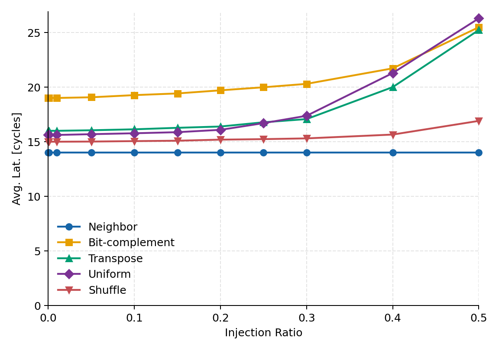

# Mesh traffic 量測場景與結果

資料快照：2026-11-11 07:54 UTC。範圍：#28、原生 4×4／VIP、85 runs。整體效能量測尚未結束。

## 論文對應與圖

使用五種 synthetic traffic patterns，評估 wide accesses 的平均頻寬利用率，以及 narrow accesses 的平均延遲。

[FlooNoC，arXiv:2409.17606v2，Fig.8／p.9](https://arxiv.org/pdf/2409.17606v2#page=9)

- 上圖原文："Average bandwidth utilization of wide accesses"
- 下圖原文："Average latency of narrow accesses"

[BW SVG](figures/bandwidth.svg)

[Latency SVG](figures/latency.svg)

## 量測條件

| 項目 | 本次設定 |
|---|---|
| 平台 | 4×4 mesh；每 node 配置 1×AXI source VIP、1×NI（NMU＋NSU）、1×router（REQ／RSP／DAT）、1×AXI device VIP（記憶體模型） |
| AXI、NoC clock frequency | 1 GHz |
| Wide accesses | 512-bit reads；每來源傳輸 1／2／4／8／16／32 KiB |
| Narrow accesses | 每來源 32 筆 8 B single-beat reads |

Source VIP 產生 AXI 流量，device VIP 提供記憶體回應。

完整設定、seed 與 burst 拆分見 [條件快照](runs/uniform-16kib/config/paper-conditions.json) 與 [run record](runs/uniform-16kib/runs/uniform_16kib/uniform_16kib.run.json)。

來源節點 $s$ 的座標為 $(x,y)$，目的節點 $d$ 的座標為 $(x_d,y_d)$。每列有 4 個節點，因此編號為 $s=4y+x$、$d=4y_d+x_d$，各座標皆為 0 至 3。例如 $(2,1)$ 對應 NI6。下表用這些符號描述各 pattern 的目的地。

| Pattern | Mapping |
|---|---|
| Neighbor | $(x_d,y_d)=((x+1)\bmod4,y)$ |
| Bit-complement | $(x_d,y_d)=(3-x,3-y)$ |
| Transpose | $(x_d,y_d)=(y,x)$ |
| Uniform | $d_s\sim\mathcal{U}(\{0,\ldots,15\}\setminus\{s\})$ |
| Shuffle | $q=4x+y,\quad d=2(q\bmod8)+\lfloor q/8\rfloor$ |

Uniform 使用 seed 42，按 x、y 順序產生 mapping。每個 source 固定一個 nonself destination，全部 jobs 重用。
確切 pairs、輸入與來源保存在各 result 的 config／provenance／inputs。

## Avg. BW Util [%]

單位：%。數值為各 source 的有效 payload bandwidth 相對於 64 bytes/cycle 上限的利用率，再對 16 個 sources 取平均。顯示六位小數。完整精度見 [bandwidth.csv](tables/bandwidth.csv)。論文標示 kB，繪圖程式以 1024 bytes 換算，本表以 KiB 表示。

| Pattern | 1 KiB | 2 KiB | 4 KiB | 8 KiB | 16 KiB | 32 KiB |
| --- | --- | --- | --- | --- | --- | --- |
| Neighbor | 44.817927 | 61.793103 | 76.314363 | 86.532645 | 92.768028 | 96.244652 |
| Bit-complement | 26.229719 | 34.314027 | 40.646050 | 44.671174 | 47.198603 | 48.556448 |
| Transpose | 36.055250 | 45.997161 | 53.582848 | 58.567541 | 61.419472 | 62.955989 |
| Uniform | 36.060726 | 47.902016 | 57.622172 | 64.291842 | 59.172038 | 56.942737 |
| Shuffle | 38.702593 | 50.517336 | 60.089366 | 66.566632 | 70.492421 | 72.664915 |

## Avg. Latency [cycles]

單位：cycles。量測 source AXI 的 AR handshake 到第一筆 R handshake，除以 clock period，再對交易及 sources 取平均。圖表直接使用 CSV 的 mean_latency_cycles。顯示六位小數。完整精度見 [latency.csv](tables/latency.csv)。

| 設定注入參數／zero-load | Neighbor (cycles) | Bit-complement (cycles) | Transpose (cycles) | Uniform (cycles) | Shuffle (cycles) |
| --- | --- | --- | --- | --- | --- |
| 0 (isolated) | 14.000000 | 19.000000 | 16.000000 | 15.625000 | 15.000000 |
| 0.001 | 14.000000 | 19.013672 | 16.005859 | 15.625000 | 15.005859 |
| 0.01 | 14.000000 | 19.013672 | 16.005859 | 15.625000 | 15.005859 |
| 0.05 | 14.000000 | 19.076172 | 16.054688 | 15.695312 | 15.019531 |
| 0.1 | 14.000000 | 19.273438 | 16.142578 | 15.779297 | 15.060547 |
| 0.15 | 14.000000 | 19.427734 | 16.279297 | 15.878906 | 15.097656 |
| 0.2 | 14.000000 | 19.712891 | 16.398438 | 16.093750 | 15.195312 |
| 0.25 | 14.000000 | 19.992188 | 16.785156 | 16.707031 | 15.242188 |
| 0.3 | 14.000000 | 20.304688 | 17.078125 | 17.380859 | 15.310547 |
| 0.4 | 14.000000 | 21.724609 | 20.003906 | 21.292969 | 15.660156 |
| 0.5 | 14.000000 | 25.494141 | 25.234375 | 26.298828 | 16.912109 |

0 為本案的隔離 zero-load 基準：全網同時最多一筆未完成交易，每 source 仍量 32 筆。圖的正值 X 軸使用設定注入參數。實際 AR 接受率另存於 CSV。候選 driver 抽整數 u∈[0,100]，接受條件為 u<100ρ。0.001 與 0.01 均僅 u=0 成功。

## 本次計算公式

兩項指標均對全部 16 個 source 的結果取等權平均，包含 mapping 中的 local accesses。

Latency 圖與表使用 cycles，對應 CSV 的 mean_latency_cycles 欄位。[本次重繪程式快照](provenance/latency-performance.py) 與 [重繪紀錄](provenance/latency-plot.json)。

公式來源：[run.py／tile_performance](runs/uniform-16kib/provenance/source/dv/scripts/run.py) 與 [performance.py](provenance/performance.py)。

### Avg. BW Util

$$
C_i=\left\lfloor\frac{t_{\mathrm{DONE},i}-t_{\mathrm{ENABLE},i}}{T_{\mathrm{clk}}}\right\rfloor+1
$$

$$
U_i[\%]=100\frac{B_i}{64C_i},\qquad
\mathrm{Avg.\ BW\ Util}[\%]=\frac{1}{N}\sum_{i=1}^{N}U_i
$$

- $N=16$。$B_i$：source i 在 phase 1 的有效 read bytes。
- $C_i$：第一個 ENABLE 取樣 edge 到該 source 的 SOURCE_DONE，包含尾端取樣。
- 64 bytes/cycle：本次 full-width 512-bit source payload peak。
- 每個 source 使用自己的窗口，再做等權平均。

| 公式值 | summary.json 欄位 |
|---|---|
| $B_i$ | source_tiles[].directions.read.useful_bytes |
| $C_i$ | source_tiles[].monitor_window.cycles |
| $U_i$ | source_tiles[].directions.read.monitor_payload_utilization_percent |
| Avg. BW Util | source_tile_average.read.monitor_payload_utilization_percent |

### Avg. Latency

$$
L_{ij}[\mathrm{cycles}]=\frac{t_{\mathrm{first\ R},ij}-t_{\mathrm{AR},ij}}{T_{\mathrm{clk}}}
$$

$$
L_i=\frac{1}{M_i}\sum_{j=1}^{M_i}L_{ij},\qquad
\mathrm{Avg.\ Latency}=\frac{1}{N}\sum_{i=1}^{N}L_i
$$

- AR、first R 皆為 source AXI accepted handshake。兩個時間戳與 clock period 使用相同單位。
- 本次 $N=16$、每 source $M_i=32$。
- 圖取 first-R latency。原始資料亦保留 RLAST completion latency。
- 每筆：transactions.csv 的 first_response_latency_ps。每 source：mean_first_response_latency_cycles。
- 圖上平均：source_tile_average.read.mean_first_response_latency_cycles。

### 實際 AR 接受率

$$
r_i=\frac{(M_i-1)T_{\mathrm{clk}}}{t_{\mathrm{last\ AR},i}-t_{\mathrm{first\ AR},i}},\qquad
\bar r=\frac{1}{N}\sum_{i=1}^{N}r_i
$$

對應 latency-sources.csv 與 latency.csv 的 actual_injection_ratio。Zero-load 的圖上座標為 0。其實際接受率仍照實保存。

## 資料位置

| 檔案 | 內容 |
|---|---|
| [bandwidth.csv](tables/bandwidth.csv) | BW 圖 30 點、result root、build／summary／FSDB hashes |
| [latency.csv](tables/latency.csv) | Latency 圖 55 點、設定／實際注入率、FSDB hash |
| [latency-sources.csv](tables/latency-sources.csv) | 880 列逐 source latency、交易數與時間 |
| [summary.json 範例](runs/uniform-16kib/tables/summary.json) | 逐 source bytes／窗口／利用率與平均 |
| [transactions.csv 範例](runs/uniform-16kib/tables/transactions.csv) | 逐筆 AR／first-R／completion 時間、beats、bytes |
| [原始 AXI events 範例](runs/uniform-16kib/runs/uniform_16kib/axi-events.csv) | 接受事件與 ENABLE／SOURCE_DONE 標記 |
| [條件與論文對照範例](runs/uniform-16kib/config/paper-conditions.json) | 論文條件、本次條件、差異與引用 |
| [run.json 範例](runs/uniform-16kib/runs/uniform_16kib/uniform_16kib.run.json) | 實際 command、clock、seed、source／binary／FSDB hashes |
| [validation.json 範例](runs/uniform-16kib/validation.json) | Checker／drain、FSDB 校準、inputs 重現與 review |
| [plot-SHA256SUMS](provenance/plot-SHA256SUMS) | 圖、表與繪圖程式快照的 hashes |

由 bandwidth.csv 的 root、latency.csv 的 run 可找到每點 result。其 runs 子目錄內保留本身的 FSDB、原 RC 與本機 view.rc。

## 與論文的比較邊界

- 原文平台為 8×4 compute mesh。本次為 4×4／VIP。
- 原文 Fig.8 以 cycles 顯示，plots.py 的 narrow latency 另加 7 cycles cluster 成本。本表同樣使用 cycles，保留本平台 source AXI 邊界，未加上該成本。
- Mapping 參照 candidate add4108261bbb2516311072b2989351b9bddab2d。exact experiment RTL revision 尚未核實。
- 正注入率集合來自封存 source 中的 commented narrow config。原圖第一點約為 0.001。
- 結果保留 publication_result=false。原生平台範圍已驗收。

來源：[arXiv v2 source](https://arxiv.org/src/2409.17606v2)、[封存設定](runs/uniform-32kib/provenance/reference/paper-source/measurements/mesh_test_cfg.json)、[原文繪圖程式](runs/uniform-32kib/provenance/reference/paper-source/scripts/plots.py)、[原文 Fig.8](runs/uniform-32kib/provenance/reference/paper-source/figures/traffic_patterns.pdf)。

## 本檔資料快照

CSV 為數值依據。後續更新圖／CSV 時，同步更新本檔表格、條件、公式與下列 hashes。

    4a929f58354cde20b2affdcd6226143b530192f4f751a00494783ba417fcbdde  tables/bandwidth.csv
    7d814b9db4046f301f9a65067c6c9e25736133c0b913df17f24ab7f7accd6ffa  tables/latency.csv
    31be0d1b3e06b21af733cc3cb3edd0a7591b988ec0f71d49dec7cf0c96ef75df  tables/latency-sources.csv
