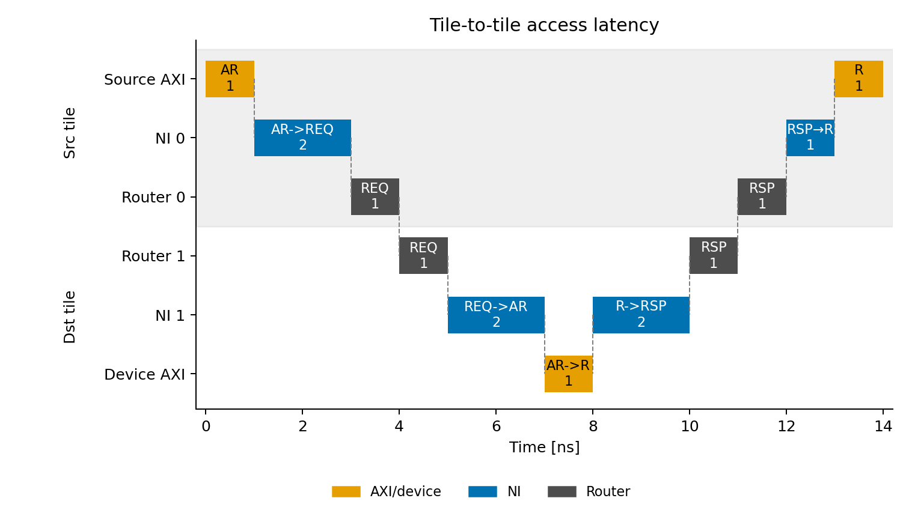

# Tile-to-tile 量測場景與結果

## 1. 量測場景

NI0 → NI1 的單筆 8 B narrow read，經 REQ 送出 AR、RSP 回傳 R。以時間軸呈現 source AXI、NI、router 與 device 的延遲分解，對應 [FlooNoC Fig.7](https://arxiv.org/html/2409.17606v2#S6.SS1) 的呈現方式。



## 2. 工作量與條件

| 項目 | 設定 |
|---|---|
| 平台 | 原生 4×4 mesh／VIP |
| 來源／目的 | NI0 (0,0) → NI1 (1,0)，相鄰 tile |
| 交易 | 1 筆 read，1 beat × 8 B |
| AXI／NoC clock | 1 ns，phase 0 |
| 取樣 | VALID assertion 與 VALID、READY 同時成立的握手 edge |

本圖重用既有 result。編譯來源、設定與 seed／hash 依 [recipe](config/recipe.json) 與 [run record](runs/perf_ctrl_read_neighbor/perf_ctrl_read_neighbor.run.json)，未以目前 HEAD 重跑。

## 3. 指標與公式

圖的起點為 source ARVALID assertion，終點為 source R handshake。單位均為 ns。

```text
Stage latency = t_end − t_begin
Total latency = t_source_R − t_source_ARVALID = 21.5 − 7.5 = 14 ns
AXI round trip = t_source_R − t_source_AR = 21.5 − 8.5 = 13 ns
```

這是本平台的取樣邊界，包含 source AR 與 R 的等待。FlooNoC 的 cluster／LSU 與 SPM interconnect 成本未套入本圖。

## 4. 實驗結果

| 部分 | 延遲 [ns] |
|---|---:|
| Source ARVALID → AR handshake | 1 |
| NI0：AR → REQ | 2 |
| Router0 → Router1：REQ | 2 |
| NI1：REQ → AR | 2 |
| Device：AR → R | 1 |
| NI1：R → RSP | 2 |
| Router1 → Router0：RSP | 2 |
| NI0：RSP → RVALID | 1 |
| Source RVALID → R handshake | 1 |
| 合計 | 14 |

原始資料：[分段表](tables/tile-to-tile-breakdown.csv)、[事件時間](tables/tile-to-tile-events.csv)、[結果摘要](tables/tile-to-tile.json)、[重繪紀錄](provenance/tile-to-tile-plot.json)。

波形：[FSDB](runs/perf_ctrl_read_neighbor/perf_ctrl_read_neighbor.fsdb)。重繪沿用 `make -C sim perf_tile_plot RESULT=<result>`，輸出位置需尚未有圖表，以保護既有產物。
