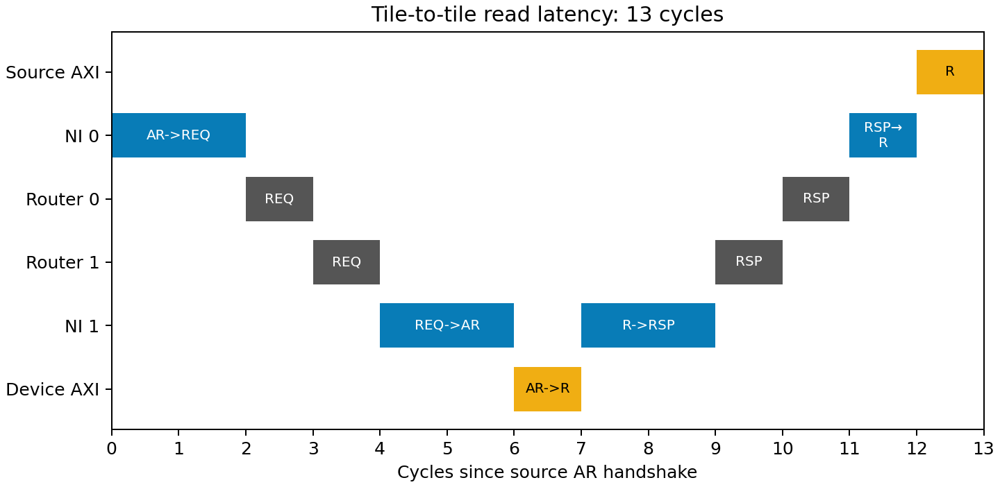

# Tile-to-tile read latency

## 1. Measurement setup

量測 NI0 向相鄰 NI1 讀取一筆 8 B 資料的延遲。

以時間軸呈現 source AXI、NI、router 與 device 的延遲分解，對應 [FlooNoC Fig.7](https://arxiv.org/html/2409.17606v2#S6.SS1) 的呈現方式。

## 2. Workload and parameters

| Parameter | Value |
| --- | --- |
| Platform | 4×4 mesh with AXI VIP |
| Source and destination | NI0 (0,0) → NI1 (1,0), adjacent tiles |
| Transaction | One 8 B read, one beat |
| AXI and NoC clock period | 1 ns, phase 0 |

本圖重用既有 result。編譯來源、設定與 seed／hash 依 [recipe](config/recipe.json) 與 [run record](runs/perf_ctrl_read_neighbor/perf_ctrl_read_neighbor.run.json)，未以目前 HEAD 重跑。

## 3. Read latency breakdown

- **讀取延遲：13 cycles**。來源 AR handshake 在 8.5 ns，來源 R handshake 在 21.5 ns。
- **請求去程，6 cycles**：來源 NI、兩個 REQ router 合計、目的 NI 各使用 2 cycles。
- **記憶體回應，1 cycle**：目的端從 AR handshake 到第一個 R handshake。
- **資料回程，6 cycles**：目的 NI 使用 2 cycles，兩個 RSP router 合計 2 cycles，來源 NI 收到回應到來源 R handshake 再用 2 cycles。

原始資料：[分段表](tables/tile-to-tile-breakdown.csv)、[事件時間](tables/tile-to-tile-events.csv)、[結果摘要](tables/tile-to-tile.json)、[重繪紀錄](provenance/tile-to-tile-plot.json)。

波形：[FSDB](runs/perf_ctrl_read_neighbor/perf_ctrl_read_neighbor.fsdb)。
